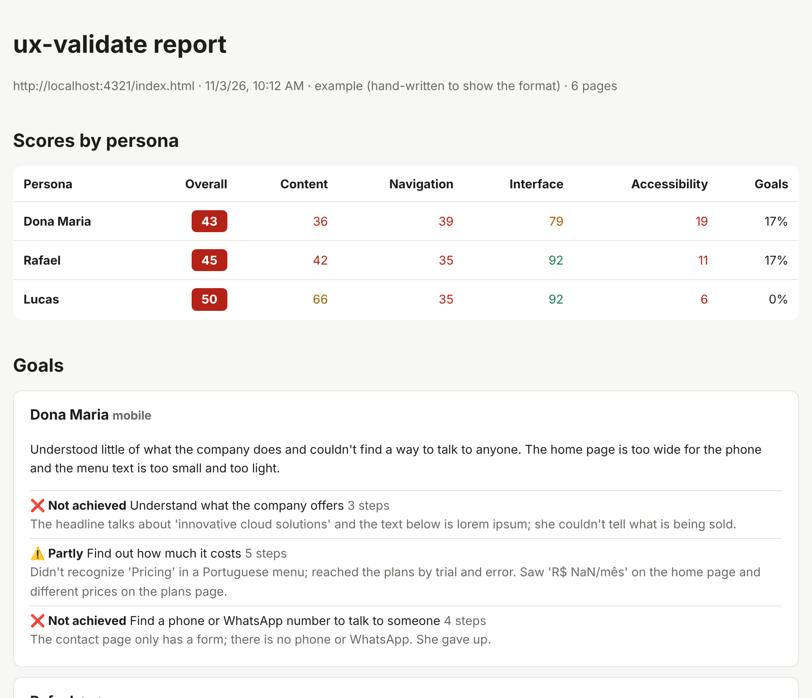

# ux-validate

**English** · [Português](README.pt-BR.md)

Persona-based testing of the **content**, **navigation**, **interface** and **accessibility** of web apps, whether AI-generated or not, run by the AI agent you already use.

Instead of just saying "contrast is below 4.5:1", ux-validate answers: *can Margaret, 68, on her phone, find out how much your product costs?* And if she can't, it shows where she got stuck, why, and which file to fix.



> **Status:** early version (0.1). Works with **Claude Code**, **Cursor**, **Codex CLI** and **Gemini CLI**.

## How it works

```
/persona-test
   │
   ├─ 1. Automated checks  (npx ux-validate check)
   │     axe-core, WAI-ARIA and keyboard, broken links, console errors,
   │     horizontal scrolling, spelling, placeholder text (lorem ipsum, NaN)…
   │     → same result with any language model
   │
   ├─ 2. Browsing as each persona  (agent + Playwright MCP)
   │     tries to achieve their goals, with their limitations,
   │     and evaluates content, navigation, interface and accessibility
   │     through their eyes; tests widgets with the keyboard (APG patterns)
   │     and reviews spelling and grammar
   │
   ├─ 3. Points to the likely file for each issue in your code
   │
   └─ 4. Report  (npx ux-validate report)
         scores by persona, goals achieved, issues with evidence
         and suggested fixes → report.md + report.html

/persona-fix  or  npx ux-validate fix
   └─ applies the fixes to the code, showing each change before saving
```

ux-validate runs **inside your AI tool**: the model used is whichever one that tool is using.

## Supported AI tools

Setup installs the same commands (`persona-test`, `persona-report`, `persona-fix`, `persona-new`) in each tool's own format, plus the Playwright MCP server the agent uses as its browser. You can pick several tools at once.

| Tool | Commands are installed in | How to call them | Browser (MCP) registered in |
|---|---|---|---|
| **Claude Code** | `.claude/skills/<name>/SKILL.md` | `/persona-test` | `.mcp.json` |
| **Cursor** | `.cursor/commands/<name>.md` | `/persona-test` in the agent chat | `.cursor/mcp.json` |
| **Codex CLI** | `.agents/skills/<name>/SKILL.md` (with `agents/openai.yaml`) | `$persona-test` | `.codex/config.toml` |
| **Gemini CLI** | `.gemini/commands/<name>.toml` | `/persona-test` | `.gemini/settings.json` |

Notes:

- The commands only run when you call them: the tests open a browser and use tokens. In Claude Code this is `disable-model-invocation`; in Codex, `allow_implicit_invocation: false`.
- Codex reads `.codex/config.toml` and Gemini reads `.gemini/settings.json` only in folders you **trust**; accept the prompt the first time you open the project.
- Existing config files are preserved: setup only adds the `playwright` server if it isn't there.
- Gemini CLI also reads `.agents/skills/`. If you install both Codex and Gemini, Gemini may list the Codex skills too; use the `/persona-…` commands, and Gemini asks for confirmation before activating any skill.
- Arguments go after the command name in every tool, e.g. `/persona-test margaret` or `$persona-test margaret`.

## Languages

ux-validate speaks **English** and **Portuguese**: terminal messages, setup, report, check findings and agent instructions.

- Setup detects your system language and asks which one to use. The choice is saved as `locale` in `ux-validate.config.yml`.
- To switch for a single command: `npx ux-validate check --lang pt-BR`.
- The **tool's language** (`locale`) is separate from the **language of your app's content** (`language`), which the spell check uses. You can run the tool in English on a site written in Portuguese, and vice versa.

## Accessibility and WAI-ARIA

The **Accessibility** category combines three layers:

| Layer | What it checks |
|---|---|
| **axe-core** | ARIA syntax (valid roles, attributes and values), accessible names, contrast, alternative text and the other WCAG 2.2 AA rules |
| **ARIA behavior checks** | Tabs through every page and finds: keyboard traps, invisible focus, focus on hidden elements, widgets with a `role` that can't receive focus, clickable elements with no keyboard access (`<div onclick>`), `aria-expanded` that doesn't change on open/close, fields labeled only by a placeholder |
| **Agent** | Tests each widget with the keyboard following the [ARIA Authoring Practices Guide](https://www.w3.org/WAI/ARIA/apg/) (dialogs, tabs, accordions, menus, combobox…), checks whether dynamic messages are announced (`role="status"`/`alert`) and browses as a screen reader user would |

Each run also saves every page's **accessibility tree** in `.ux-validate/runs/<date-time>/aria/`: roles, names and states, i.e. what a screen reader announces. The report links each accessibility issue to its page's tree.

## Spell check

Spelling is checked **offline**, with Hunspell and the LibreOffice dictionaries. No text leaves your machine. Languages: English, Brazilian Portuguese and Spanish (`language` in `ux-validate.config.yml`).

- Flags unknown words with suggested corrections (`recieve` → `receive`) and, in Portuguese or Spanish content, English words in the middle of the text.
- Ignores proper names, brands (`WhatsApp`), acronyms, URLs, emails and template variables.
- Correct words the dictionary doesn't know (your company name, technical terms) go in `.ux-validate/dictionary.txt` (or `dicionario.txt` when the tool runs in Portuguese; both are read), one per line, or in `spelling.ignore` in the config.
- In `/persona-test`, the agent reviews these findings, discards false positives and reviews the **grammar** ("their" × "there", "its" × "it's"…), which the dictionary doesn't catch.

## Applying the fixes

After the report, ux-validate can fix the code for you, in two ways:

| | `/persona-fix` (in Claude Code) | `npx ux-validate fix` (in the terminal) |
|---|---|---|
| **Model** | Whatever Claude Code is using | The provider and model chosen in setup: Anthropic, OpenAI, Google or Ollama (local) |
| **Cost** | Usage of your Claude Code account | Tokens billed to **your** provider account, with **your** API key |
| **How it works** | The agent fixes one issue at a time and runs the checks again to confirm | Sends each file with its issues to the model, gets the proposed text replacements and shows the diff before saving |

Both fix only what is in the report, prefer semantic HTML over ARIA and **never make up data** (phone numbers, prices, testimonials): when information is missing, they tell you what's needed.

```bash
npx ux-validate fix                       # critical, high and medium issues from the latest run
npx ux-validate fix --ids A001,C003       # only these issues
npx ux-validate fix --severity high       # only critical and high
npx ux-validate fix --dry-run             # show the fixes without saving
```

Before calling the model, `fix` shows which files it will send and an estimate of tokens, and asks for confirmation. Each proposed replacement must match exactly one unique piece of the file; those that don't are discarded. The original files are saved in `.ux-validate/runs/<date-time>/fixes/backup/`, and the result for each issue (with the tokens used) in `fixes/fixes.json`.

> **Privacy:** with `fix` in the terminal, the content of the files being fixed is sent to the chosen provider. With Ollama, everything runs on your machine.

The API key is never stored in `ux-validate.config.yml`, which only keeps the name of the environment variable. Set the key before running:

```bash
export ANTHROPIC_API_KEY=your-key
```

```powershell
$env:ANTHROPIC_API_KEY="your-key"
```

## Installation

Requirements: **Node.js 20+** and one of the supported AI tools: **Claude Code**, **Cursor**, **Codex CLI** or **Gemini CLI**.

In the project you want to test:

```bash
npm install -D ux-validate
```

```bash
npx playwright install chromium
```

```bash
npx ux-validate init
```

Setup asks for:

- the **tool's language** (English or Portuguese);
- **which AI tools** you'll use the commands in (Claude Code, Cursor, Codex CLI, Gemini CLI; one or more);
- the app's **URL** and, optionally, the command to start it;
- the **screen sizes** (mobile, tablet, desktop);
- the **language of the content**, for the spell check;
- whether to set up a **model to apply fixes from the terminal** (`npx ux-validate fix`): **provider** (Anthropic, OpenAI, Google, Ollama), **model** and the name of the environment variable holding your API key;
- whether to create **example personas**.

And creates:

| File | Purpose |
|---|---|
| `ux-validate.config.yml` | Configuration |
| `.ux-validate/personas/*.yml` | Your personas |
| `.ux-validate/references/` | Heuristics and formats the agent consults |
| `.ux-validate/dictionary.txt` | Correct words the dictionary doesn't know |
| The commands and MCP files for each chosen tool | See [Supported AI tools](#supported-ai-tools) |

Use `--yes` to accept the defaults without questions, `--tools claude-code,cursor,codex,gemini` to choose the tools without questions, and `--force` to overwrite existing files.

## Usage

In your AI tool, inside your project (in Codex, use `$` instead of `/`):

| Command | What it does |
|---|---|
| `/persona-new` | Creates a persona by talking with you about who uses the app |
| `/persona-test` | Tests with every persona and builds the report |
| `/persona-test margaret` | Tests with a single persona |
| `/persona-test --only accessibility` | Evaluates a single category (`content`, `navigation`, `ui`, `accessibility`) |
| `/persona-report` | Rebuilds the latest run's report and drafts a fix plan |
| `/persona-report --compare` | Shows what was resolved, what remains and what's new |
| `/persona-fix` | Applies the report's fixes (critical, high and medium) |
| `/persona-fix A001,C003` | Applies only the fixes for these issues |

From the terminal (useful in CI):

```bash
npx ux-validate persona new      # create a persona with a step-by-step wizard
npx ux-validate persona validate # check the persona files
npx ux-validate check            # automated checks only
npx ux-validate report           # report for the latest run
npx ux-validate fix              # apply the fixes with the model set up in init
```

Results go in `.ux-validate/runs/<date-time>/` (already added to `.gitignore`).

## Personas

A persona is a real kind of user of your app, written as a YAML file in `.ux-validate/personas/`. Setup creates three examples; to create your own:

- **`/persona-new` in Claude Code:** the agent interviews you about the real user (who they are, which device, limitations, what they come to do), can look at your app to suggest goals, shows the file and saves it after you confirm. You can start with a description: `/persona-new older customer who shops on their phone`.
- **`npx ux-validate persona new` in the terminal:** a step-by-step wizard with multiple-choice questions for each trait. It doesn't use a language model.

Both check the file with `npx ux-validate persona validate`, which you can also run any time to check every persona in the project (required fields, valid values, repeated ids).

```yaml
id: margaret
name: Margaret
description: 68, retired, uses her phone with her grandson's help.
viewport: mobile
traits:
  tech_literacy: low        # raises the weight of jargon and unlabeled icons
  vision: reduced           # raises the weight of contrast and small fonts
  patience: low             # gives up after a few steps without progress
  language: en
  reading_level: basic
goals:
  - Find out how much it costs
  - Find a phone number to talk to a person
```

Full format and the effect of each trait: [`source/en/references/persona-format.md`](source/en/references/persona-format.md). Trait values can be in English or Portuguese.

## Try it with the demo site

`examples/demo-site` is a site with problems planted on purpose (broken links, lorem ipsum, a layout that overflows on mobile, an inaccessible form, tabs and an accordion with broken ARIA, spelling mistakes…). Its content is in Portuguese, which also shows the tool and content languages working independently. Great for seeing the tool at work before using it on your project.

**1. Clone and serve the site** (keep this terminal open):

```bash
git clone https://github.com/fabiofigueredo/ux-validate.git
```

```bash
cd ux-validate && npm install && npx playwright install chromium
```

```bash
npm run demo:serve
```

The site is at http://localhost:4321/index.html.

**2. Create a test project** in another terminal, next to the `ux-validate` folder:

```bash
mkdir test-project && cd test-project && npm init -y
```

```bash
npm install -D ../ux-validate
```

```bash
npx ux-validate init
```

When setup asks for the URL, enter `http://localhost:4321/index.html`, and choose **Portuguese (Brazil)** as the content language.

> You can also test HTML files straight from disk, with no server, using a `file://` URL (e.g. `file:///C:/projects/my-site/index.html`). Prefer `http://` whenever the app has a server: that's how real users will reach it.

**3. Run the automated checks:**

```bash
npx ux-validate check
```

```bash
npx ux-validate report
```

Open `report.html` in `.ux-validate/runs/<date-time>/`.

**4. Run the persona test:** open the `test-project` folder in VS Code, open Claude Code, approve the `playwright` MCP server (or enable it with `/mcp`) and type `/persona-test margaret`.

`examples/sample-findings.en.json` shows the kind of result the agent produces.

### Troubleshooting

| Symptom | Fix |
|---|---|
| `/persona-test` doesn't show up | The open folder must be the project where you ran `init` (the one with `.claude/`, `.cursor/`, `.agents/` or `.gemini/`). In Gemini CLI, run `/commands reload` |
| The agent has no browser tools | Approve or enable the `playwright` MCP server in your tool; in Codex and Gemini, trust the project folder |
| Error saying the browser wasn't found | Run `npx playwright install chromium` in the project |
| "The start page doesn't open" | Check that the app is running and that `app.url` is right |
| You want to change the URL after setup | Edit `app.url` in `ux-validate.config.yml` |

## Project structure

```
bin/ux-validate.js           CLI (init, check, report, fix, persona)
src/init.js                  interactive setup
src/checks.js                automated checks (Playwright + axe-core)
src/aria.js                  WAI-ARIA and keyboard checks
src/spelling.js              spell check (Hunspell)
src/fix.js                   automatic fixes from the report
src/llm.js                   provider clients (Anthropic, OpenAI, Google, Ollama)
src/persona.js               persona wizard and validation
src/report.js                scores and report (Markdown + HTML)
src/i18n.js                  tool language
src/locales/                 messages in English (en.js) and Portuguese (pt-BR.js)
src/adapters/                one adapter per AI tool
source/<lang>/commands/      commands written once, independent of the AI tool
source/<lang>/references/    heuristics, content guide, WAI-ARIA guide, persona and findings formats
source/<lang>/personas/      example personas
examples/                    demo site and sample results
test/                        tests (npm test)
```

### Adding an AI tool

The commands in `source/<lang>/commands/` use placeholders (`{{WORK_DIR}}`, `{{CHECK_CMD}}`…) and don't depend on any tool. To support a new one, create `src/adapters/<tool>.js` with `{ id, label, available: true, invoke(name), install({ cwd, commands, force }) }`, writing the commands in the format that tool understands (`src/adapters/shared.js` has helpers to adapt the argument placeholder and register the MCP server), register it in `src/adapters/index.js`, and add its next-step line to `init.next.tools` in the message catalogs.

### Adding a language

1. Copy `src/locales/en.js` to `src/locales/<lang>.js`, translate it and register it in `src/i18n.js`.
2. Copy `source/en/` to `source/<lang>/` and translate the commands, references and personas.
3. Run `npm test`: a test checks that every catalog has the same keys.

## Roadmap

- [x] Interactive setup, Claude Code adapter, `/persona-test` and `/persona-report`
- [x] Automated checks and report with scores by persona
- [x] Accessibility with WAI-ARIA, and spell check
- [x] `/persona-fix` and `npx ux-validate fix` (apply fixes with the user's model)
- [x] English and Portuguese
- [x] Adapters for Cursor, Codex CLI and Gemini CLI
- [x] `/persona-new` and `npx ux-validate persona new` (create personas)
- [ ] Persona browsing from the terminal (no AI tool), with the model chosen in setup
- [ ] GitHub Action with a PR comment and SARIF output
- [ ] Repeat the browsing and only confirm issues that show up in more than one run

## Contributing

Suggestions and PRs are welcome. Run `npm test` before opening a PR. To change the agent's behavior, edit the commands in `source/<lang>/commands/` and the references in `source/<lang>/references/` (keep both languages in sync): they apply to every AI tool.

## Environment variables

| Variable | Purpose |
|---|---|
| `UX_VALIDATE_LOCALE` | Tool language (`en` or `pt-BR`) when the config has no `locale` |
| `UX_VALIDATE_CHROMIUM` | Path to an already-installed Chromium, if you don't want Playwright's |
| `ANTHROPIC_API_KEY`, `OPENAI_API_KEY`, `GOOGLE_GENERATIVE_AI_API_KEY` | API key used by `npx ux-validate fix` (the variable name is configurable in setup) |
| `DEBUG` | Shows the full error when a command fails |

## License

[MIT](LICENSE) © Fabio Figueredo
