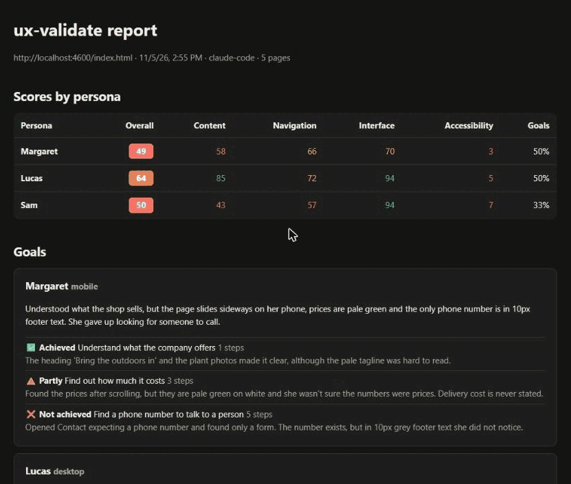

# ux-validate

**English** · [Português](README.pt-BR.md)

Persona-based testing of the **content**, **navigation**, **interface** and **accessibility** of web apps, whether AI-generated or not, run by the AI agent you already use.

Instead of just saying "contrast is below 4.5:1", ux-validate asks, through a simulated persona: *can Margaret, 68, on her phone, find out how much your product costs?* And if she can't, it shows where she got stuck, why, and what to fix.



> **Status:** version 1.3. Works with **Claude Code**, **Cursor**, **Codex CLI** and **Gemini CLI**. Website: [fabiofigueredo.github.io/ux-validate](https://fabiofigueredo.github.io/ux-validate/)

## Contents

- [What it does](#what-it-does)
- [Quick start](#quick-start)
- [How it works](#how-it-works)
- [Installation and setup](#installation-and-setup)
- [Usage](#usage)
- [Personas](#personas)
- [Tasks](#tasks)
- [Auditing a published site](#auditing-a-published-site)
- [The report](#the-report)
- [What is checked](#what-is-checked)
- [Applying the fixes](#applying-the-fixes)
- [GitHub Action and CI](#github-action-and-ci)
- [Limitations](#limitations)
- [Try it with the demo site](#try-it-with-the-demo-site)
- [Troubleshooting](#troubleshooting)
- [Development](#development)
- [Roadmap](#roadmap)

## What it does

ux-validate tests web apps in two situations, and in two layers:

| | **Your project** (in development, with the code) | **A published site** (only the URL) |
|---|---|---|
| **Automated checks** · no AI | `npx ux-validate check` | `npx ux-validate audit <url>` |
| **Persona and task test** · needs an AI tool | `/ux-test` | `/ux-audit <url>` |

- **Automated checks** run in the terminal, with no language model, and always give the same result: accessibility (axe-core, WAI-ARIA, keyboard, color blindness), broken links, console errors, layout on mobile, spelling and placeholder text left behind (lorem ipsum, `NaN`, `TODO`).
- **The persona and task test** runs inside your AI tool. The agent runs the automated checks, opens the app in a browser and tries the [tasks](#tasks) as each [persona](#personas) would, with their device and limitations. It records where they got lost and why and, in your project, which file to fix.
- **The result** is a report (`report.html` and `report.md`) with scores by persona, the tasks each one completed, the issues with evidence and how to fix them. See [The report](#the-report).

> **Important: the persona and task test requires AI.** It only runs inside an AI tool with an agent (Claude Code, Cursor, Codex CLI or Gemini CLI), using that tool's model and account. **Without one, ux-validate runs only the automated checks**, and the report says so at the top.

ux-validate is a **first-pass check**: it points out likely barriers before you test with people, not instead of it. See [Limitations](#limitations).

## Quick start

Requirements: **Node.js 20+** and, for the persona test, one of the AI tools above.

### In your project

Once, in a terminal, in the project folder:

```bash
npm install -D ux-validate
```

```bash
npx ux-validate install-browser
```

```bash
npx ux-validate init
```

`init` asks for the language, your AI tools, the app's URL and start command, the client and logo for the report (optional), the **personas** and the **tasks** they will try. Then, for each validation:

1. Open your AI tool **in the project folder** and run **`/ux-test`** (in Codex, `$ux-test`). The first time, approve the `playwright` MCP server: it's the agent's browser.
2. Open `report.html` in the latest folder in `.ux-validate/runs/`.
3. To fix: `/ux-fix` in your AI tool, or `npx ux-validate fix` in the terminal.

Without AI: `npx ux-validate check` and then `npx ux-validate report` (automated part only).

### A published site

In any folder, for a site you are responsible for or are authorized to test:

```bash
npx ux-validate audit https://www.example.com
```

With personas and tasks: `/ux-audit https://www.example.com` in your AI tool. Details in [Auditing a published site](#auditing-a-published-site).

### Claude Code plugin

An alternative to the npm package for Claude Code users. In Claude Code, once:

```
/plugin marketplace add fabiofigueredo/ux-validate
```

```
/plugin install ux-validate@ux-validate
```

Then, in each project: `/ux-validate:ux-setup` once and `/ux-validate:ux-test` for each validation. See [Claude Code plugin](#claude-code-plugin).

### In CI

The [GitHub Action](#github-action-and-ci) runs the automated checks (no AI) on every pull request, with a PR comment and SARIF.

## How it works

```
/ux-test  (or /ux-audit <url> for a published site)
   │
   ├─ 1. Automated checks       npx ux-validate check  (or audit)
   │     axe-core, WAI-ARIA and keyboard, color blindness, links, console errors,
   │     horizontal scrolling, spelling, placeholder text
   │     → same result with any language model; a short summary for the agent
   │
   ├─ 2. Browsing as each persona       agent + Playwright MCP
   │     tries the tasks and their own goals, with their limitations;
   │     records the first click, backtracks and where they got lost;
   │     tests widgets with the keyboard and reviews spelling and grammar
   │
   ├─ 3. Points to the likely file for each issue  (your project only)
   │
   └─ 4. Report       npx ux-validate report
         scores by persona, tasks, issues with evidence and fixes
         → report.html + report.md

/ux-fix  or  npx ux-validate fix
   └─ applies the fixes to the code, showing each change before saving
```

ux-validate runs **inside your AI tool**: the model is whichever one that tool is using.

## Installation and setup

There are two ways to install, with the same features: the **npm package**, which works with every supported AI tool and in CI, and the **Claude Code plugin**, an alternative for those who prefer installing it once in Claude Code. Use one or the other in the same project.

### npm package

In the project you want to test:

```bash
npm install -D ux-validate
```

```bash
npx ux-validate install-browser
```

```bash
npx ux-validate init
```

`install-browser` installs the Chromium that matches the Playwright version ux-validate uses. `init` asks for:

- the **tool's language** (English or Portuguese);
- **which AI tools** you'll use (Claude Code, Cursor, Codex CLI, Gemini CLI; one or more);
- the **client's name and logo** for the report (optional);
- the app's **URL** and the **command to start it** (`app.start`). With it, `check` starts the app when it isn't running and stops it at the end. Setup suggests it for React projects and for plain HTML sites (`npx -y http-server <folder> -p 3000 -c-1`);
- the **screen sizes** (mobile, tablet, desktop) and the **language of the content**, for the spell check;
- optionally, a **model to apply fixes from the terminal** (`npx ux-validate fix`): provider, model and the name of the environment variable with your API key;
- **which personas to use** (mandatory): it shows the predefined personas with their characteristics, and you choose them (all or some), create your own, or both;
- **which tasks the personas should try** (mandatory): goals without step-by-step.

It creates:

| File | Purpose |
|---|---|
| `ux-validate.config.yml` | Configuration |
| `.ux-validate/personas/*.yml` | Your personas |
| `.ux-validate/tasks.yml` | The tasks the personas try |
| `.ux-validate/references/` | Heuristics and formats the agent consults |
| `.ux-validate/dictionary.txt` | Correct words the dictionary doesn't know |
| The commands and MCP file for each tool | See [Supported AI tools](#supported-ai-tools) |

Without questions: `--yes` accepts the defaults, `--tools claude-code,cursor,codex,gemini` chooses the tools, `--personas all|none|margaret,raj-dev` chooses the predefined personas, `--task "…"` adds a task (repeatable), `--url` and `--start` set the app, `--client` and `--logo` the report's client and logo. `--force` overwrites existing files.

> **Upgrading from a version before 0.3?** The agent commands were renamed (`/persona-test` → `/ux-test`, `/persona-report` → `/ux-report`, `/persona-fix` → `/ux-fix`, `/persona-new` → `/ux-persona`). Run `npx ux-validate init` again: it installs the new ones and removes the old ones.

### Claude Code plugin

Install once and use it in any project:

```
/plugin marketplace add fabiofigueredo/ux-validate
```

```
/plugin install ux-validate@ux-validate
```

| Skill | What it does |
|---|---|
| `/ux-validate:ux-setup` | Sets up the project: language, URL, start command, personas and tasks (once) |
| `/ux-validate:ux-test` | Tests with every persona and builds the report |
| `/ux-validate:ux-audit <url>` | Audits a published site, without its code |
| `/ux-validate:ux-report` | Rebuilds the report and a fix plan |
| `/ux-validate:ux-fix` | Applies the fixes from the report |
| `/ux-validate:ux-persona` | Creates a persona by talking with you |
| `/ux-validate:ux-task` | Creates tasks for the personas to try |

- The plugin brings the agent's browser (Playwright MCP) and the reference guides; there's nothing to copy into the project, and you don't need the npm package.
- The skills call the CLI pinned to the plugin's version (`npx -y ux-validate@<version>`). Requires **Node.js 20+**.
- Its instructions are in English, but the agent talks to you and writes the report in the project's language (`locale`: `en` or `pt-BR`).
- **Updating:** `claude plugin marketplace update ux-validate`, then `claude plugin update ux-validate@ux-validate`, and restart Claude Code (or use `/plugin` inside Claude Code).
- If the project already has the commands from `npx ux-validate init` for Claude Code (`.claude/skills/ux-*` and the `playwright` entry in `.mcp.json`), remove them before using the plugin, to avoid duplicated commands.

### Supported AI tools

`init` installs the same commands in each tool's own format, plus the Playwright MCP server the agent uses as its browser:

| Tool | Commands are installed in | How to call them | Browser (MCP) registered in |
|---|---|---|---|
| **Claude Code** | `.claude/skills/<name>/SKILL.md` | `/ux-test` | `.mcp.json` |
| **Cursor** | `.cursor/commands/<name>.md` | `/ux-test` in the agent chat | `.cursor/mcp.json` |
| **Codex CLI** | `.agents/skills/<name>/SKILL.md` (with `agents/openai.yaml`) | `$ux-test` | `.codex/config.toml` |
| **Gemini CLI** | `.gemini/commands/<name>.toml` | `/ux-test` | `.gemini/settings.json` |

- The commands only run when you call them, because the tests open a browser and use tokens (in Claude Code, `disable-model-invocation`; in Codex, `allow_implicit_invocation: false`).
- Codex and Gemini read their config files only in folders you **trust**; accept the prompt the first time you open the project.
- Existing config files are preserved: `init` only adds the `playwright` server if it isn't there, or updates the one an earlier ux-validate version wrote.
- The Playwright MCP server is installed at a **pinned version** (`@playwright/mcp@0.0.83`, with `--console-level error`), not `@latest`, so no new, unreviewed version runs without you knowing.
- Gemini CLI also reads `.agents/skills/`. With Codex and Gemini in the same project, Gemini may list the Codex skills too; use the `/ux-…` commands.

### Languages

ux-validate speaks **English** and **Portuguese**: terminal messages, setup, report, findings and agent instructions.

- `init` detects your system language and saves the choice as `locale` in `ux-validate.config.yml`. For a single command: `--lang pt-BR`.
- The **tool's language** (`locale`) is separate from the **language of your app's content** (`language`), used by the spell check: you can run the tool in English on a site written in Portuguese. In an audit, the content language comes from the site's `<html lang>`.

## Usage

### In your AI tool

Persona and task tests run **only inside your AI tool**, in the project folder (in Codex, use `$` instead of `/`; with the plugin, `/ux-validate:` before the name):

| Command | What it does |
|---|---|
| `/ux-test` | Tests with every persona and builds the report |
| `/ux-test margaret` | Tests with a single persona |
| `/ux-test --only accessibility` | Evaluates a single category (`content`, `navigation`, `ui`, `accessibility`) |
| `/ux-audit https://www.example.com` | Audits a published site, without its code |
| `/ux-report` | Rebuilds the latest run's report and drafts a fix plan |
| `/ux-report --compare` | Shows what was resolved, what remains and what's new |
| `/ux-fix` | Applies the report's fixes (critical, high and medium) |
| `/ux-fix A001,C003` | Applies only the fixes for these issues |
| `/ux-persona` | Creates a persona by talking with you about who uses the app |
| `/ux-task` | Creates tasks for the personas to try |

**Saving tokens.** The agent reads a short summary of the automated checks (`checks-brief.md`) instead of the full `checks.json`, tests each persona in a clean context when the tool has subagents (Claude Code), and opens color-blindness images and accessibility trees only where needed. To spend even less, test one persona (`/ux-test margaret`) or one category (`--only accessibility`).

### In the terminal (no AI)

```bash
npx ux-validate check                # automated checks of your project
npx ux-validate audit <url>          # automated audit of a published site
npx ux-validate report               # report for the latest run
npx ux-validate fix                  # apply the fixes with the model set up in init
npx ux-validate persona examples     # show the predefined personas and their characteristics
npx ux-validate persona add all      # copy the predefined ones into the project (or: add margaret)
npx ux-validate persona new          # create a persona with a step-by-step wizard
npx ux-validate persona validate     # check the persona files
npx ux-validate task new             # create tasks for the personas to try
npx ux-validate task validate        # check the tasks file
npx ux-validate sarif                # export the issues as SARIF (code scanning)
npx ux-validate comment              # Markdown summary for a pull request comment
npx ux-validate install-browser      # install the browser (Chromium)
```

General options: `--lang en|pt-BR`, `--config <file>`, `--dir <folder>` (run the command in another folder, e.g. an audit's) and `--help`.

### Where the results go

Each run creates `.ux-validate/runs/<date-time>/` (already in `.gitignore`):

| File | Contents |
|---|---|
| `report.html` (+ `report-*.html`, `report.css`) / `report.md` | The report: a small site (home page plus one page per area) and the Markdown version |
| `checks.json` | Automated check results, in full |
| `checks-brief.md` | Short summary the agent reads |
| `findings.json` | The agent's evaluation by persona |
| `screenshots/`, `color-vision/`, `aria/` | Screenshots, pages as seen with color blindness, accessibility trees |

## Personas

A persona is a real kind of user of your app, written as a YAML file in `.ux-validate/personas/`. There's no test without at least one persona, so **choosing personas is mandatory**: in setup and, if the folder is empty, at the start of `/ux-test`.

### Predefined personas

| Persona | Who they are | Device | Tech literacy | Vision | Patience | Reading | Goals |
|---|---|---|---|---|---|---|---|
| **Margaret** (`margaret`) | 68, retired; uses messaging and her banking app, sometimes with her grandson's help | Phone | Low | Reduced | Low | Basic | Understand what the company offers; find out the price; find a phone number |
| **Lucas** (`lucas-screen-reader`) | 35, financial analyst, blind since childhood; uses a screen reader and keyboard | Computer | High | Screen reader | Medium | Advanced | Understand the offer by navigating headings only; fill in the contact form |
| **Raj** (`raj-dev`) | 29, developer; evaluates tools for the team and compares with competitors | Computer | High | Normal | Medium | Advanced | Compare plans and limits; create a trial account; find the docs |
| **Tom** (`tom-color-blind`) | 45, sales manager; has deuteranopia (red-green color blindness) | Computer | Medium | Color-blind | Medium | Intermediate | Find the price; tell which option is selected; understand form errors |

`npx ux-validate persona examples` shows the full cards; `npx ux-validate persona add <id>` or `all` adds them. Adjust the goals to your product.

### Create your own

- **`/ux-persona` in your AI tool:** the agent interviews you about the real user (who they are, device, limitations, what they come to do), can look at your app to suggest goals, and saves the file after you confirm. You can start with a description: `/ux-persona older customer who shops on their phone`.
- **`npx ux-validate persona new`:** a step-by-step wizard in the terminal, with no language model.

```yaml
id: margaret
name: Margaret
description: 68, retired, uses her phone with her grandson's help.
viewport: mobile
traits:
  tech_literacy: low        # raises the weight of jargon and unlabeled icons
  vision: reduced           # raises the weight of contrast and small fonts
  patience: low             # gives up after a few steps without progress
  language: en
  reading_level: basic
goals:
  - Find out how much it costs
  - Find a phone number to talk to a person
```

`npx ux-validate persona validate` checks every persona (required fields, valid values, repeated ids). Full format and the effect of each trait: [`source/en/references/persona-format.md`](source/en/references/persona-format.md). Trait values can be in English or Portuguese.

## Tasks

Tasks are what the personas try to do in your app, as in a task-based usability test: **the goal, with no step-by-step**. The test checks whether each persona finds the way on their own. They live in `.ux-validate/tasks.yml` and apply to every persona, unless a task lists only some.

```yaml
- id: cheapest-plan-price
  task: You want to know how much the cheapest plan costs.
  success: The page shows the price of the cheapest plan.   # optional: where to get, not how
- id: talk-to-someone
  task: You have a question about your order and want to talk to a person.
  personas: [margaret]                                       # optional
```

- **Mandatory:** `init` asks for at least one task after the personas (`--task "…"` without questions). If there are none, `/ux-test` asks before testing.
- **Writing them:** the goal, not the path ("You want to know how much the cheapest plan costs", not "Click Pricing…"), and without the exact words of menus and buttons. `/ux-task` helps you write them, and `check` warns when a task uses the exact label of a link or button, because that gives the answer away.
- **What the agent records** for each persona and task: the outcome (judged by `success` when there is one), steps, the **first click** and whether it was on the right path, **backtracks**, and where they got lost, with a screenshot.

Commands: `npx ux-validate task new` and `npx ux-validate task validate`. Format: [`source/en/references/tasks-format.md`](source/en/references/tasks-format.md).

## Auditing a published site

The same validation works on a site that is **already online**, from its URL, without its source code. **Only audit sites you are responsible for or are authorized to test.**

```bash
npx ux-validate audit https://www.example.com
```

- **No project and no setup.** It runs in any folder. Each site gets its own folder, `ux-validate-audits/<domain>/`, with its personas, tasks and one folder per run with `report.html`. The next audit of the same site reuses them, and `/ux-audit` compares with the previous run. Inside a Git repository, `ux-validate-audits/` is added to `.gitignore`.
- **Safe for a live site.** It asks whether you are responsible for the site or authorized to test it (`--yes` confirms it, e.g. in CI), respects `robots.txt`, visits at most one page per second, identifies itself as `ux-validate` in the user agent, doesn't follow sign out, delete or cancel links, and never submits forms. The personas go as far as the final button of a form, login or purchase, and stop there.
- **With personas and tasks:** `/ux-audit <url>` in your AI tool asks for the authorization, the personas and the tasks, runs the audit and browses as each persona. To use it without the plugin, install the commands once in any folder: `npx ux-validate init --tools claude-code` (or `cursor`, `codex`, `gemini`).
- **The report** adds "Limits of this audit" (pages not visited and what couldn't be tested) and a "Plan for whoever maintains the site": first what stops people from finishing their tasks, then critical and high issues, then the rest grouped by kind. Each issue shows the page, the element and a screenshot instead of the file and line. To share it with whoever maintains the site, send the whole run folder.
- **Options:** `--personas margaret,lucas-screen-reader` or `all`, `--task "<task>"` (repeatable), `--max-pages 20`, `--viewports mobile,desktop`, `--fail-on high`, `--client "<name>"` and `--logo <file or URL>`. Other commands work in the site's folder with `--dir`, e.g. `npx ux-validate report --dir ux-validate-audits/www.example.com`.
- **What doesn't apply:** file and line, React component names, `fix` and `sarif`, which work on the project's code. Pages behind a login aren't audited yet.

## The report

The report is a small site in the run folder, with the ux-validate visual identity. `report.html` is the home page, and each area has its own page, linked from a menu at the top:

| Page | Contents |
|---|---|
| **Overview** (`report.html`) | The main numbers (average score, tasks completed, goals not achieved, issues by severity), each persona's score, **Fix first** (the critical and high issues, with the file to fix) and shortcuts to the other areas |
| **Personas** | A card for each persona: overall score from 0 to 100, a bar per category, traits, summary and goals. Each persona only loses points for the issues that affect them |
| **Tasks** | A task × persona table with the outcome and the number of steps, and where each persona got lost (first click, backtracks, notes and screenshot) |
| **Issues** | Every issue, closed in one line, opening with the evidence, the WCAG criterion, the snippet, how to fix it and the screenshot. Filters by category, severity and persona |
| **Color vision** | Each page as seen with each type of color blindness |
| **Audit scope** | Audit only: the pages analyzed and what was left out. In an audit, the overview shows the **Fix plan** for whoever maintains the site instead of "Fix first" |

- **Client and logo:** shown at the top of every page. `init` and `/ux-audit` ask for them (optional), or set them in `ux-validate.config.yml`; a local logo is copied into the run folder.

  ```yaml
  report:
    client: Client name
    logo: ./client-logo.png   # image file (png, jpg, svg, webp) or https:// URL
  ```

- **Footer:** who evaluated (AI tool and model), the date and the ux-validate version.
- **Sharing:** send the whole run folder (e.g. as a zip): the pages, `report.css`, the logo and the screenshots go together.
- `report.md` has all the content in a single Markdown file. The HTML report is light only and loads its fonts from Google Fonts; offline, it uses the system fonts.

## What is checked

### Accessibility and WAI-ARIA

| Layer | What it checks |
|---|---|
| **axe-core** | ARIA syntax, accessible names, contrast, alternative text and the other WCAG 2.2 AA rules |
| **Behavior checks** | Tabs through every page and finds keyboard traps, invisible focus, focus on hidden elements, widgets with a `role` that can't receive focus, clickable elements with no keyboard access (`<div onclick>`), `aria-expanded` that doesn't change, fields labeled only by a placeholder |
| **Agent** | Tests each widget with the keyboard following the [ARIA Authoring Practices Guide](https://www.w3.org/WAI/ARIA/apg/) (dialogs, tabs, accordions, menus, combobox…), checks whether dynamic messages are announced and browses as a screen reader user would |

Each run also saves every page's **accessibility tree** (what a screen reader announces) in `aria/`, linked from the report.

### Color vision (color blindness)

About 1 in 12 men and 1 in 200 women have some form of color blindness. ux-validate simulates **protanopia**, **deuteranopia** and **tritanopia** (and, optionally, **achromatopsia**) with the Machado, Oliveira and Fernandes (2009) matrices, compares colors with CIEDE2000 and finds:

| Check | What it finds |
|---|---|
| `cvd-contrast` | Text that passes the WCAG contrast but falls below the minimum with color blindness |
| `cvd-indicators` | Status dots, legend markers and other indicators without text whose colors become the same |
| `cvd-state` | A selected tab, filter or menu item that differs from its neighbors only by color |

These issues count only for personas with `vision: color-blind`, like **Tom**. In `/ux-test`, the agent also browses with color blindness simulated, looking for what the check can't catch (charts, errors shown only in red). To choose the types or turn it off:

```yaml
colorVision:
  enabled: true
  types: [protanopia, deuteranopia, tritanopia]   # also: achromatopsia
```

### Spelling

Checked **offline**, with Hunspell and the LibreOffice dictionaries: no text leaves your machine. Languages: English, Brazilian Portuguese and Spanish.

- Flags unknown words with suggestions (`recieve` → `receive`) and, in Portuguese or Spanish content, English words in the middle of the text.
- Ignores proper names, brands, acronyms, URLs, emails and template variables.
- Correct words the dictionary doesn't know go in `.ux-validate/dictionary.txt` (one per line) or in `spelling.ignore` in the config.
- In `/ux-test`, the agent discards false positives and reviews the **grammar** ("their" × "there", "its" × "it's"), which the dictionary doesn't catch.

### Content and layout

Broken links (including "page not found" screens in SPAs), links with no destination, console errors and resources that fail to load, horizontal scrolling on mobile, text too small to read, and leftovers that shouldn't reach users: lorem ipsum, `undefined`/`NaN`, unrendered template variables (`{{plan.limit}}`), `TODO`, sample data.

### React apps and SPAs

It works with any React setup (Vite, Next.js, Create React App, React Router, Remix, Gatsby) and does more for apps that switch screens without reloading:

- **Setup** detects the framework and suggests the development server URL and command (e.g. Vite → `http://localhost:5173` and `npm run dev`).
- **Where to fix:** on the development server, each issue comes with the **component** (`Home › App`) and the **JSX file and line** (`src/App.jsx:9`), used by the report, SARIF and `fix`.
- **Routes:** waits for React to render, follows History API and hash routes, and recognizes the app's "not found" screen even when the server answers 200.
- **Checks:** blank page (render error without an Error Boundary), React warnings (`key`, hydration, invalid nesting, render loops, controlled/uncontrolled fields), route changes that don't move focus or change the tab title, and `<div onClick>` with no keyboard access.

Screens without a link (opened by a button, for example) go in the config:

```yaml
crawl:
  routes: [/checkout, /account/orders]
```

With a production build the checks still work, but without component names or files. A sample app with issues on purpose is in `examples/react-demo` (`npm run demo:react`).

## Applying the fixes

| | `/ux-fix` (in your AI tool) | `npx ux-validate fix` (in the terminal) |
|---|---|---|
| **Model** | Whatever your AI tool is using | The provider and model chosen in setup: Anthropic, OpenAI, Google or Ollama (local) |
| **Cost** | Usage of your AI tool's account | Tokens billed to **your** provider account, with **your** API key |
| **How it works** | The agent fixes one issue at a time and runs the checks again | Sends each file with its issues to the model and shows the diff before saving |

Both fix only what is in the report, prefer semantic HTML over ARIA and **never make up data** (phone numbers, prices, testimonials): when information is missing, they tell you what's needed.

```bash
npx ux-validate fix                       # critical, high and medium issues from the latest run
npx ux-validate fix --ids A001,C003       # only these issues
npx ux-validate fix --severity high       # only critical and high
npx ux-validate fix --dry-run             # show the fixes without saving
```

Before calling the model, `fix` shows which files it will send and an estimate of tokens, and asks for confirmation. Original files are saved in `fixes/backup/` inside the run folder. The API key is never stored in the config, only the name of its environment variable:

```bash
export ANTHROPIC_API_KEY=your-key
```

```powershell
$env:ANTHROPIC_API_KEY="your-key"
```

> **Privacy:** with `fix` in the terminal, the content of the files being fixed is sent to the chosen provider. With Ollama, everything runs on your machine.

## GitHub Action and CI

Runs the automated checks on every pull request, with a summary comment, annotations on the changed lines (SARIF / code scanning) and the full report as an artifact. The persona test needs an AI tool and runs locally.

```yaml
# .github/workflows/ux-validate.yml
name: ux-validate
on: pull_request

permissions:
  contents: read
  pull-requests: write   # PR comment
  security-events: write # SARIF upload to code scanning

jobs:
  ux:
    runs-on: ubuntu-latest
    steps:
      - uses: actions/checkout@v7
      - uses: actions/setup-node@v7
        with:
          node-version: 22
      - run: npm ci
      - uses: fabiofigueredo/ux-validate@v1
        with:
          start: npm run dev
          url: http://localhost:3000
          fail-on: critical
```

| Input | Default | What it does |
|---|---|---|
| `url` | `app.url` from the config | URL to test (a local server or a preview deployment) |
| `start` | — | Command that starts the app in the background; the action waits for the URL |
| `wait-timeout` | `120` | Seconds to wait for the URL |
| `working-directory` | `.` | Folder of the app (monorepos) |
| `fail-on` | — (never fails) | Fail the job with issues of this severity or worse: `critical`, `high`, `medium`, `low` |
| `comment` | `true` | Post a summary on the PR, updating the same comment on every push |
| `sarif` | `true` | Upload SARIF to code scanning |
| `upload-sarif` | `true` | With `false`, builds the SARIF file without sending it to code scanning |
| `language` | config `locale`, then English | `en` or `pt-BR` for the comment and report |

Outputs: `issues`, `critical`, `high`, `report-dir`, `sarif-file`.

- `@v1` points to the latest stable release; to freeze one, use its tag (e.g. `@v1.2.0`).
- Code scanning is free on public repositories; on private ones it needs GitHub Advanced Security. Without it, the SARIF upload is skipped with a warning.
- On pull requests from forks, GitHub gives a read-only token: the comment step is skipped with a warning.
- A sample workflow is in [`examples/github-workflow.yml`](examples/github-workflow.yml).

In any other CI:

```bash
npx ux-validate check --url http://localhost:3000 --fail-on high   # exit code 2 when the threshold is hit
npx ux-validate sarif --out ux-validate.sarif
npx ux-validate comment --out comment.md
```

## Limitations

ux-validate is a **first-pass check**. It doesn't replace manual accessibility testing or testing with real people, including people with disabilities.

- **What runs without AI:** `check` and `audit` use no language model (axe-core, keyboard and ARIA behavior, links, console errors, layout, offline spell check, placeholder text, color blindness and React checks).
- **What needs an external AI tool:** the persona test runs inside Claude Code, Cursor, Codex CLI or Gemini CLI, which are proprietary tools. The ux-validate CLI is open source (MIT); those tools are not.
- **Automation covers only part of WCAG.** In an informal test by the author (2026-11-17), `check` ran on the 142 test pages of [alphagov/accessibility-tool-audit](https://github.com/alphagov/accessibility-tool-audit). It detected about a third of the cases, in the same range as axe alone (40 of 141) and below the best paid tool (56 of 141), with no false positives on the control page. This is an informal test, not a study.
- **Personas are simulated by AI.** They can repeat the models' biases, and they have not been validated against real people. Use them as a support, never as a substitute for research with people.
- **Audits** see only public pages: forms, login and payment are left out.

## Try it with the demo site

`examples/demo-site` is a site with problems on purpose (broken links, lorem ipsum, a layout that overflows on mobile, an inaccessible form, tabs and an accordion with broken ARIA, spelling mistakes…). Its content is in Portuguese, which also shows the tool and content languages working independently.

**1. Clone and serve the site** (keep this terminal open):

```bash
git clone https://github.com/fabiofigueredo/ux-validate.git
```

```bash
cd ux-validate && npm install && node bin/ux-validate.js install-browser
```

```bash
npm run demo:serve
```

The site is at http://localhost:4321/index.html.

**2. Create a test project** in another terminal, next to the `ux-validate` folder:

```bash
mkdir test-project && cd test-project && npm init -y
```

```bash
npm install -D ../ux-validate
```

```bash
npx ux-validate init
```

Enter `http://localhost:4321/index.html` as the URL and choose **Portuguese (Brazil)** as the content language.

**3. Run the automated checks:** `npx ux-validate check` and `npx ux-validate report`, then open `report.html` in `.ux-validate/runs/<date-time>/`.

**4. Run the persona test:** open `test-project` in your AI tool, approve the `playwright` MCP server and run `/ux-test margaret`.

You can also test HTML files straight from disk with a `file://` URL. Prefer `http://` whenever the app has a server: that's how users reach it. `examples/sample-findings.en.json` shows the kind of result the agent produces.

## Troubleshooting

| Symptom | Fix |
|---|---|
| "Nothing is responding at http://localhost:…" | The app isn't running. Start it, or set `app.start` in `ux-validate.config.yml` (plain HTML site: `npx -y http-server <folder> -p 3000 -c-1`) |
| `Cannot find package 'yaml'` when running `npx ux-validate` | You are inside a clone of the ux-validate repository without its dependencies. Run `npm install` there, or run the command from another folder |
| `/ux-test` doesn't show up | Open your AI tool in the folder where you ran `init`. In Gemini CLI, run `/commands reload` |
| The agent has no browser tools | Approve or enable the `playwright` MCP server; in Codex and Gemini, trust the project folder |
| The browser wasn't found | Run `npx ux-validate install-browser` |
| A plugin command fails with "404 Not Found" | The plugin's version isn't on npm yet; wait for the release or update the plugin |
| You want to change the URL after setup | Edit `app.url` in `ux-validate.config.yml` |

## Development

### From the source

```bash
git clone https://github.com/fabiofigueredo/ux-validate.git
```

```bash
cd ux-validate && npm install && node bin/ux-validate.js install-browser
```

```bash
npm test
```

To use your clone in a project, run `npm install -D /path/to/ux-validate` in that project and continue from `init`. To test the plugin locally: `npm run build:plugin` in the clone and `claude --plugin-dir /path/to/ux-validate/plugin` in the project (the plugin's skills call the CLI published on npm at the plugin's version).

### Project structure

```
bin/ux-validate.js           CLI
src/init.js                  interactive setup
src/checks.js                automated checks (Playwright + axe-core)
src/aria.js                  WAI-ARIA and keyboard checks
src/color.js                 color blindness simulation and checks
src/react.js                 React and SPA support
src/spelling.js              spell check (Hunspell)
src/tasks.js                 tasks
src/persona.js               persona wizard and validation
src/audit.js, src/robots.js  audit of a published site, robots.txt
src/app-server.js            starts the app with app.start
src/brief.js                 short summary of the checks for the agent
src/report.js                scores and report (Markdown + HTML)
src/fix.js, src/llm.js       automatic fixes and provider clients
src/sarif.js, src/comment.js SARIF export and pull request comment
src/i18n.js, src/locales/    messages in English and Portuguese
src/adapters/                one adapter per AI tool
source/<lang>/               agent commands, references and predefined personas
source/plugin/, plugin/      Claude Code plugin (plugin/ is generated: npm run build:plugin)
action.yml                   GitHub Action
docs/                        website (GitHub Pages)
examples/                    demo sites and sample results
test/                        tests (npm test)
```

### Adding an AI tool

The commands in `source/<lang>/commands/` use placeholders (`{{WORK_DIR}}`, `{{CHECK_CMD}}`…) and don't depend on any tool. Create `src/adapters/<tool>.js` with `{ id, label, available: true, invoke(name), install({ cwd, commands, force }) }` (`src/adapters/shared.js` has helpers), register it in `src/adapters/index.js` and add its next-step line to `init.next.tools` in the message catalogs.

### Adding a language

1. Copy `src/locales/en.js` to `src/locales/<lang>.js`, translate it and register it in `src/i18n.js`.
2. Copy `source/en/` to `source/<lang>/` and translate the commands, references and personas.
3. Run `npm test`: a test checks that every catalog has the same keys.

### Contributing

Suggestions and PRs are welcome. Run `npm test` before opening a PR. To change the agent's behavior, edit `source/<lang>/commands/` and `source/<lang>/references/` (keep both languages in sync) and run `npm run build:plugin`.

### Environment variables

| Variable | Purpose |
|---|---|
| `UX_VALIDATE_LOCALE` | Tool language (`en` or `pt-BR`) when the config has no `locale` |
| `UX_VALIDATE_CHROMIUM` | Path to an already-installed Chromium |
| `ANTHROPIC_API_KEY`, `OPENAI_API_KEY`, `GOOGLE_GENERATIVE_AI_API_KEY` | API key for `npx ux-validate fix` (the variable name is configurable) |
| `DEBUG` | Shows the full error when a command fails |

## Roadmap

- [x] Automated checks, persona test and report with scores by persona
- [x] Accessibility with WAI-ARIA, spell check and color blindness
- [x] Fixes with `/ux-fix` and `npx ux-validate fix`
- [x] English and Portuguese; Claude Code, Cursor, Codex CLI and Gemini CLI
- [x] GitHub Action with a PR comment and SARIF
- [x] React apps and SPAs
- [x] Claude Code plugin
- [x] Tasks: goals without step-by-step, first click, backtracks
- [x] Audit of a published site from its URL
- [x] Report with the ux-validate visual identity
- [x] Report as a site, one page per area, with the client's logo
- [ ] Audit pages behind a login (saved session)
- [ ] Persona browsing from the terminal (no AI tool), with the model chosen in setup
- [ ] Repeat the browsing and only confirm issues that show up in more than one run

## License

[MIT](LICENSE) © Fabio Figueredo
