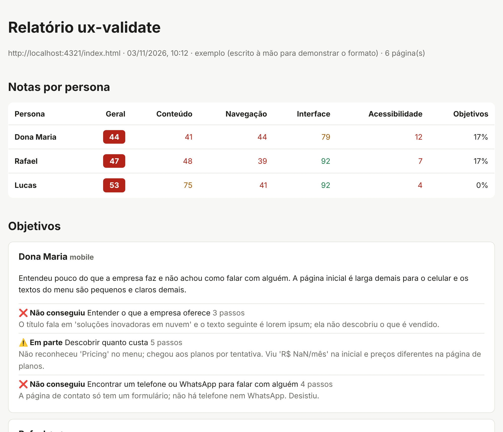

# ux-validate

Testes de **conteúdo**, **navegação**, **interface** e **acessibilidade** de aplicações web, feitos do ponto de vista de **personas**, geradas por IA ou não, e executados pelo agente de IA que você já usa.

Em vez de só dizer "o contraste está abaixo de 4,5:1", o ux-validate responde: *a Dona Maria, de 68 anos, no celular, consegue descobrir quanto custa o seu produto?* E se não consegue, mostra onde ela travou, por quê e em qual arquivo corrigir.



> **Status:** versão inicial (0.1). Funciona com o Claude Code; outras ferramentas de IA estão no [roadmap](#roadmap).

## Como funciona

```
/persona-test
   │
   ├─ 1. Checagens fixas  (npx ux-validate check)
   │     axe-core, WAI-ARIA e teclado, links quebrados, erros de console,
   │     rolagem horizontal, textos provisórios (lorem ipsum, TODO, NaN)…
   │     → mesmo resultado com qualquer modelo de linguagem
   │
   ├─ 2. Navegação como cada persona  (agente + Playwright MCP)
   │     tenta cumprir os objetivos dela, com as limitações dela,
   │     e avalia conteúdo, navegação, interface e acessibilidade
   │     pelo olhar dela; testa os widgets pelo teclado (padrões do APG)
   │
   ├─ 3. Aponta o arquivo provável de cada problema no seu código
   │
   └─ 4. Relatório  (npx ux-validate report)
         notas por persona, objetivos cumpridos, problemas com evidência
         e sugestão de correção → report.md + report.html
```

O ux-validate roda **dentro da sua ferramenta de IA**: o modelo usado é o que ela estiver usando.

## Acessibilidade e WAI-ARIA

A categoria **Acessibilidade** combina três camadas:

| Camada | O que verifica |
|---|---|
| **axe-core** | Sintaxe do ARIA (papéis, atributos e valores válidos), nomes acessíveis, contraste, textos alternativos e demais regras WCAG 2.2 AA |
| **Checagens ARIA de comportamento** | Percorre cada página com `Tab` e encontra: armadilha de teclado, foco invisível, foco em elemento escondido, widgets com `role` que não recebem foco, elementos clicáveis sem acesso pelo teclado (`<div onclick>`), `aria-expanded` que não muda ao abrir e fechar, campos identificados só pelo placeholder |
| **Agente** | Testa cada widget pelo teclado seguindo o [ARIA Authoring Practices Guide](https://www.w3.org/WAI/ARIA/apg/) (diálogos, abas, acordeões, menus, combobox…), verifica se mensagens dinâmicas são anunciadas (`role="status"`/`alert`) e navega como uma pessoa que usa leitor de tela |

Cada execução salva também a **árvore de acessibilidade** de cada página em `.ux-validate/runs/<data-hora>/aria/`: papéis, nomes e estados, ou seja, o que um leitor de tela anuncia. O relatório liga cada problema de acessibilidade à árvore da página.

## Instalação

Pré-requisitos: **Node.js 20+** e o **[Claude Code](https://claude.com/claude-code)** (terminal ou extensão do VS Code).

No projeto que você quer testar:

```bash
npm install -D ux-validate
```

```bash
npx playwright install chromium
```

```bash
npx ux-validate init
```

O setup pergunta:

- **Em qual ferramenta de IA** você vai usar os comandos (hoje: Claude Code; Cursor, Codex e Gemini CLI em breve);
- a **URL** da aplicação e, opcionalmente, o comando para subi-la;
- os **tamanhos de tela** (mobile, tablet, desktop);
- se quer configurar o **modo standalone** (CLI/CI sem ferramenta de IA), escolhendo **provedor** (Anthropic, OpenAI, Google, Ollama) e **modelo**;
- se quer criar **personas de exemplo**.

E cria:

| Arquivo | Para quê |
|---|---|
| `ux-validate.config.yml` | Configuração |
| `.ux-validate/personas/*.yml` | Suas personas |
| `.ux-validate/references/` | Heurísticas e formatos que o agente consulta |
| `.claude/skills/persona-test/`, `persona-report/` | Comandos do Claude Code |
| `.mcp.json` | Registra o Playwright MCP (o navegador do agente) |

Use `--yes` para aceitar os padrões sem perguntas e `--force` para sobrescrever arquivos existentes.

## Uso

No Claude Code, dentro do seu projeto:

| Comando | O que faz |
|---|---|
| `/persona-test` | Testa com todas as personas e gera o relatório |
| `/persona-test dona-maria` | Testa com uma persona só |
| `/persona-test --only accessibility` | Avalia só uma categoria (`content`, `navigation`, `ui`, `accessibility`) |
| `/persona-report` | Refaz o relatório da última execução e monta um plano de correção |
| `/persona-report --compare` | Mostra o que foi resolvido, o que continua e o que é novo |

Pelo terminal (útil no CI):

```bash
npx ux-validate check            # só as checagens fixas
npx ux-validate report           # relatório da execução mais recente
```

Os resultados ficam em `.ux-validate/runs/<data-hora>/` (já incluído no `.gitignore`).

## Personas

```yaml
id: dona-maria
name: Dona Maria
description: 68 anos, aposentada, usa o celular com ajuda da neta.
viewport: mobile
traits:
  tech_literacy: baixa      # aumenta o peso de jargão e ícones sem rótulo
  vision: reduzida          # aumenta o peso de contraste e fontes pequenas
  patience: baixa           # desiste após poucos passos sem progresso
  language: pt-BR
  reading_level: básico
goals:
  - Descobrir quanto custa
  - Encontrar um telefone ou WhatsApp
```

Formato completo e efeito de cada característica: [`source/references/persona-format.md`](source/references/persona-format.md).

## Experimente com o site de demonstração

`examples/demo-site` é um site com problemas plantados de propósito (links quebrados, lorem ipsum, layout que estoura no celular, formulário inacessível, abas e acordeão com ARIA errado…). Ótimo para ver a ferramenta funcionando antes de usar no seu projeto.

**1. Clone e suba o site** (deixe este terminal aberto):

```bash
git clone https://github.com/fabiofigueredo/ux-validate.git
```

```bash
cd ux-validate && npm install && npx playwright install chromium
```

```bash
npm run demo:serve
```

O site fica em http://localhost:4321/index.html.

**2. Crie um projeto de teste** em outro terminal, ao lado da pasta `ux-validate`:

```bash
mkdir projeto-teste && cd projeto-teste && npm init -y
```

```bash
npm install -D ../ux-validate
```

```bash
npx ux-validate init
```

Quando o setup pedir a URL, informe `http://localhost:4321/index.html`.

> Também dá para testar arquivos HTML direto do disco, sem servidor, usando uma URL `file://` (ex.: `file:///C:/projetos/meu-site/index.html`). Prefira `http://` sempre que a aplicação tiver um servidor: é como o usuário real vai acessá-la.

**3. Rode as checagens fixas:**

```bash
npx ux-validate check
```

```bash
npx ux-validate report
```

Abra o `report.html` em `.ux-validate/runs/<data-hora>/`.

**4. Rode o teste com personas:** abra a pasta `projeto-teste` no VS Code, abra o Claude Code, aprove o servidor MCP `playwright` (ou ative-o com `/mcp`) e digite `/persona-test dona-maria`.

`examples/sample-findings.json` mostra o tipo de resultado que o agente produz.

### Problemas comuns

| Sintoma | Solução |
|---|---|
| `/persona-test` não aparece | A pasta aberta precisa ser a do projeto onde você rodou o `init` (a que tem `.claude/`) |
| Erro dizendo que o navegador não foi encontrado | Rode `npx playwright install chromium` no projeto |
| "A página inicial não abre" | Confira se a aplicação está no ar e se `app.url` está certa |
| Quer mudar a URL depois do setup | Edite `app.url` em `ux-validate.config.yml` |

## Estrutura do projeto

```
bin/ux-validate.js        CLI (init, check, report)
src/init.js              setup interativo
src/checks.js            checagens determinísticas (Playwright + axe-core)
src/aria.js              checagens de WAI-ARIA e teclado
src/report.js            notas e relatório (Markdown + HTML)
src/adapters/            um adapter por ferramenta de IA
source/commands/         comandos escritos uma vez, independentes da ferramenta
source/references/       heurísticas, guia de conteúdo, guia WAI-ARIA, formatos de persona e de achados
source/personas/         personas de exemplo
examples/                site de demonstração e resultado de exemplo
test/                    testes (npm test)
```

### Adicionando uma ferramenta de IA

Os comandos em `source/commands/` usam placeholders (`{{WORK_DIR}}`, `{{CHECK_CMD}}`…) e não dependem de ferramenta. Para suportar uma nova, crie `src/adapters/<ferramenta>.js` com `{ id, label, available: true, install({ cwd, commands, force }) }`, gravando os comandos no formato que ela entende, e registre-o em `src/adapters/index.js`.

## Roadmap

- [x] Setup interativo, adapter do Claude Code, `/persona-test` e `/persona-report`
- [x] Checagens fixas e relatório com notas por persona
- [ ] Adapters para Cursor, Codex CLI e Gemini CLI
- [ ] `/persona-new` (criar persona conversando) e `/persona-fix` (aplicar correções)
- [ ] Modo standalone (agente próprio via AI SDK, com o provedor e o modelo escolhidos no setup)
- [ ] GitHub Action com comentário no PR e saída SARIF
- [ ] Repetir a navegação e só confirmar problemas que aparecem em mais de uma execução

## Contribuindo

Sugestões e PRs são bem-vindos. Antes de abrir um PR, rode `npm test`. Para mudar o comportamento do agente, edite os comandos em `source/commands/` e as referências em `source/references/`: eles valem para todas as ferramentas.

## Variáveis de ambiente

| Variável | Uso |
|---|---|
| `UX_VALIDATE_CHROMIUM` | Caminho de um Chromium já instalado, se não quiser usar o do Playwright |
| `DEBUG` | Mostra o erro completo quando um comando falha |

## Licença

[MIT](LICENSE) © Fabio Figueredo
