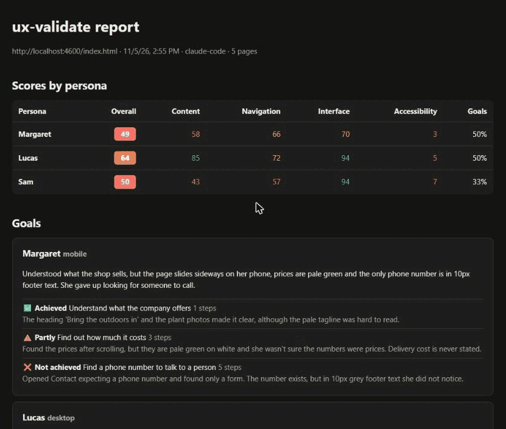

# ux-validate

[English](README.md) · **Português**

Testes de **conteúdo**, **navegação**, **interface** e **acessibilidade** de aplicações web, geradas por IA ou não, guiados por personas e executados pelo agente de IA que você já usa.

Em vez de dizer só "o contraste está abaixo de 4,5:1", o ux-validate pergunta, por meio de uma persona simulada: *a Dona Maria, de 68 anos, no celular, consegue descobrir quanto custa o seu produto?* E, se não conseguir, mostra onde ela travou, por quê e o que corrigir.



> **Status:** versão 1.3. Funciona com **Claude Code**, **Cursor**, **Codex CLI** e **Gemini CLI**. Site: [fabiofigueredo.github.io/ux-validate](https://fabiofigueredo.github.io/ux-validate/)

## Conteúdo

- [O que ele faz](#o-que-ele-faz)
- [Comece rápido](#comece-rápido)
- [Como funciona](#como-funciona)
- [Instalação e configuração](#instalação-e-configuração)
- [Uso](#uso)
- [Personas](#personas)
- [Tarefas](#tarefas)
- [Auditar um site publicado](#auditar-um-site-publicado)
- [O relatório](#o-relatório)
- [O que é verificado](#o-que-é-verificado)
- [Aplicar as correções](#aplicar-as-correções)
- [GitHub Action e CI](#github-action-e-ci)
- [Limitações](#limitações)
- [Experimente com o site de demonstração](#experimente-com-o-site-de-demonstração)
- [Solução de problemas](#solução-de-problemas)
- [Desenvolvimento](#desenvolvimento)
- [Roadmap](#roadmap)

## O que ele faz

O ux-validate testa aplicações web em duas situações, em duas camadas:

| | **Seu projeto** (em construção, com o código) | **Um site publicado** (só a URL) |
|---|---|---|
| **Checagens automáticas** · sem IA | `npx ux-validate check` | `npx ux-validate audit <url>` |
| **Teste com personas e tarefas** · precisa de uma ferramenta de IA | `/ux-test` | `/ux-audit <url>` |

- **As checagens automáticas** rodam no terminal, sem modelo de linguagem, e dão sempre o mesmo resultado: acessibilidade (axe-core, WAI-ARIA, teclado, daltonismo), links quebrados, erros de console, layout no celular, ortografia e textos provisórios esquecidos (lorem ipsum, `NaN`, `TODO`).
- **O teste com personas e tarefas** roda dentro da sua ferramenta de IA. O agente roda as checagens automáticas, abre a aplicação num navegador e tenta as [tarefas](#tarefas) como cada [persona](#personas) faria, com o aparelho e as limitações dela. Ele registra onde ela se perdeu e por quê e, no seu projeto, qual arquivo corrigir.
- **O resultado** é um relatório (`report.html` e `report.md`) com notas por persona, as tarefas que cada uma concluiu, os problemas com evidências e como corrigi-los. Veja [O relatório](#o-relatório).

> **Importante: o teste com personas e tarefas precisa de IA.** Ele só roda dentro de uma ferramenta de IA com agente (Claude Code, Cursor, Codex CLI ou Gemini CLI), com o modelo e a conta dessa ferramenta. **Sem uma delas, o ux-validate executa apenas as checagens automáticas**, e o relatório avisa isso no topo.

O ux-validate é uma **primeira checagem**: aponta barreiras prováveis antes de você testar com pessoas, não no lugar disso. Veja [Limitações](#limitações).

## Comece rápido

Requisitos: **Node.js 20+** e, para o teste com personas, uma das ferramentas de IA acima.

### No seu projeto

Uma vez, num terminal, na pasta do projeto:

```bash
npm install -D ux-validate
```

```bash
npx ux-validate install-browser
```

```bash
npx ux-validate init
```

O `init` pergunta o idioma, as suas ferramentas de IA, a URL e o comando de início da aplicação, o cliente e o logo do relatório (opcionais), as **personas** e as **tarefas** que elas vão tentar. Depois, a cada validação:

1. Abra a sua ferramenta de IA **na pasta do projeto** e rode **`/ux-test`** (no Codex, `$ux-test`). Na primeira vez, aprove o servidor MCP `playwright`: é o navegador do agente.
2. Abra o `report.html` da pasta mais recente em `.ux-validate/runs/`.
3. Para corrigir: `/ux-fix` na ferramenta de IA, ou `npx ux-validate fix` no terminal.

Sem IA: `npx ux-validate check` e depois `npx ux-validate report` (só a parte automática).

### Um site publicado

Em qualquer pasta, para um site pelo qual você responde ou que tem autorização para testar:

```bash
npx ux-validate audit https://www.exemplo.com.br
```

Com personas e tarefas: `/ux-audit https://www.exemplo.com.br` na sua ferramenta de IA. Detalhes em [Auditar um site publicado](#auditar-um-site-publicado).

### Plugin do Claude Code

Uma alternativa ao pacote do npm para quem usa o Claude Code. No Claude Code, uma vez:

```
/plugin marketplace add fabiofigueredo/ux-validate
```

```
/plugin install ux-validate@ux-validate
```

Depois, em cada projeto: `/ux-validate:ux-setup` uma vez e `/ux-validate:ux-test` a cada validação. Veja [Plugin do Claude Code](#plugin-do-claude-code).

### No CI

A [GitHub Action](#github-action-e-ci) roda as checagens automáticas (sem IA) a cada pull request, com comentário no PR e SARIF.

## Como funciona

```
/ux-test  (ou /ux-audit <url> para um site publicado)
   │
   ├─ 1. Checagens automáticas       npx ux-validate check  (ou audit)
   │     axe-core, WAI-ARIA e teclado, daltonismo, links, erros de console,
   │     rolagem horizontal, ortografia, textos provisórios
   │     → mesmo resultado com qualquer modelo; um resumo curto para o agente
   │
   ├─ 2. Navegação como cada persona       agente + Playwright MCP
   │     tenta as tarefas e os objetivos dela, com as limitações dela;
   │     registra o primeiro clique, as voltas e onde ela se perdeu;
   │     testa os widgets pelo teclado e revisa ortografia e gramática
   │
   ├─ 3. Aponta o arquivo provável de cada problema  (só no seu projeto)
   │
   └─ 4. Relatório       npx ux-validate report
         notas por persona, tarefas, problemas com evidências e correções
         → report.html + report.md

/ux-fix  ou  npx ux-validate fix
   └─ aplica as correções no código, mostrando cada mudança antes de gravar
```

O ux-validate roda **dentro da sua ferramenta de IA**: o modelo é o que essa ferramenta estiver usando.

## Instalação e configuração

Há duas formas de instalar, com os mesmos recursos: o **pacote do npm**, que funciona com todas as ferramentas de IA suportadas e no CI, e o **plugin do Claude Code**, uma alternativa para quem prefere instalar uma vez no Claude Code. Use uma ou outra no mesmo projeto.

### Pacote do npm

No projeto que você quer testar:

```bash
npm install -D ux-validate
```

```bash
npx ux-validate install-browser
```

```bash
npx ux-validate init
```

O `install-browser` instala o Chromium da versão do Playwright que o ux-validate usa. O `init` pergunta:

- o **idioma da ferramenta** (português ou inglês);
- **em quais ferramentas de IA** você vai usar os comandos (Claude Code, Cursor, Codex CLI, Gemini CLI; uma ou mais);
- o **nome e o logo do cliente** para o relatório (opcionais);
- a **URL** da aplicação e o **comando para iniciá-la** (`app.start`). Com ele, o `check` sobe a aplicação quando ela não está no ar e a encerra no fim. O setup sugere o comando para projetos React e para sites só com HTML (`npx -y http-server <pasta> -p 3000 -c-1`);
- os **tamanhos de tela** (celular, tablet, computador) e o **idioma do conteúdo**, para a ortografia;
- opcionalmente, um **modelo para aplicar correções pelo terminal** (`npx ux-validate fix`): provedor, modelo e o nome da variável de ambiente com a sua API key;
- **quais personas usar** (obrigatório): mostra as pré-definidas com as características de cada uma, e você escolhe usá-las (todas ou algumas), criar as suas ou as duas coisas;
- **quais tarefas as personas devem tentar** (obrigatório): objetivos sem passo a passo.

E cria:

| Arquivo | Para quê |
|---|---|
| `ux-validate.config.yml` | Configuração |
| `.ux-validate/personas/*.yml` | As suas personas |
| `.ux-validate/tasks.yml` | As tarefas que as personas tentam |
| `.ux-validate/references/` | Heurísticas e formatos que o agente consulta |
| `.ux-validate/dicionario.txt` | Palavras corretas que o dicionário não conhece |
| Os comandos e o arquivo de MCP de cada ferramenta | Veja [Ferramentas de IA suportadas](#ferramentas-de-ia-suportadas) |

Sem perguntas: `--yes` aceita os padrões, `--tools claude-code,cursor,codex,gemini` escolhe as ferramentas, `--personas all|none|dona-maria,rafael-dev` escolhe as personas pré-definidas, `--task "…"` acrescenta uma tarefa (pode repetir), `--url` e `--start` definem a aplicação, `--client` e `--logo` o cliente e o logo do relatório. `--force` sobrescreve arquivos existentes.

> **Vindo de uma versão anterior à 0.3?** Os comandos do agente mudaram de nome (`/persona-test` → `/ux-test`, `/persona-report` → `/ux-report`, `/persona-fix` → `/ux-fix`, `/persona-new` → `/ux-persona`). Rode `npx ux-validate init` de novo: ele instala os novos e remove os antigos.

### Plugin do Claude Code

Instale uma vez e use em qualquer projeto:

```
/plugin marketplace add fabiofigueredo/ux-validate
```

```
/plugin install ux-validate@ux-validate
```

| Skill | O que faz |
|---|---|
| `/ux-validate:ux-setup` | Configura o projeto: idioma, URL, comando de início, personas e tarefas (uma vez) |
| `/ux-validate:ux-test` | Testa com todas as personas e gera o relatório |
| `/ux-validate:ux-audit <url>` | Audita um site publicado, sem o código |
| `/ux-validate:ux-report` | Regera o relatório e um plano de correção |
| `/ux-validate:ux-fix` | Aplica as correções do relatório |
| `/ux-validate:ux-persona` | Cria uma persona conversando com você |
| `/ux-validate:ux-task` | Cria tarefas para as personas tentarem |

- O plugin traz o navegador do agente (Playwright MCP) e os guias de referência; não há nada para copiar para o projeto, e você não precisa do pacote do npm.
- As skills chamam a CLI fixada na versão do plugin (`npx -y ux-validate@<versão>`). Requer **Node.js 20+**.
- As instruções estão em inglês, mas o agente conversa com você e escreve o relatório no idioma do projeto (`locale`: `en` ou `pt-BR`).
- **Para atualizar:** `claude plugin marketplace update ux-validate`, depois `claude plugin update ux-validate@ux-validate`, e reinicie o Claude Code (ou use o `/plugin` dentro do Claude Code).
- Se o projeto já tem os comandos do `npx ux-validate init` para o Claude Code (`.claude/skills/ux-*` e a entrada `playwright` no `.mcp.json`), remova-os antes de usar o plugin, para não duplicar os comandos.

### Ferramentas de IA suportadas

O `init` instala os mesmos comandos no formato de cada ferramenta, mais o servidor MCP do Playwright que o agente usa como navegador:

| Ferramenta | Comandos instalados em | Como chamar | Navegador (MCP) registrado em |
|---|---|---|---|
| **Claude Code** | `.claude/skills/<nome>/SKILL.md` | `/ux-test` | `.mcp.json` |
| **Cursor** | `.cursor/commands/<nome>.md` | `/ux-test` no chat do agente | `.cursor/mcp.json` |
| **Codex CLI** | `.agents/skills/<nome>/SKILL.md` (com `agents/openai.yaml`) | `$ux-test` | `.codex/config.toml` |
| **Gemini CLI** | `.gemini/commands/<nome>.toml` | `/ux-test` | `.gemini/settings.json` |

- Os comandos só rodam quando você os chama, porque os testes abrem navegador e gastam tokens (no Claude Code, `disable-model-invocation`; no Codex, `allow_implicit_invocation: false`).
- O Codex e o Gemini só leem os arquivos de configuração em pastas **confiáveis**; aceite a pergunta na primeira vez que abrir o projeto.
- Arquivos de configuração existentes são preservados: o `init` só adiciona o servidor `playwright` se ele não estiver lá, ou atualiza o que uma versão anterior do ux-validate gravou.
- O servidor MCP do Playwright é instalado numa **versão fixa** (`@playwright/mcp@0.0.83`, com `--console-level error`), não em `@latest`: nenhuma versão nova e não revisada roda sem você saber.
- O Gemini CLI também lê `.agents/skills/`. Com Codex e Gemini no mesmo projeto, o Gemini pode listar as skills do Codex; use os comandos `/ux-…`.

### Idiomas

O ux-validate fala **português** e **inglês**: mensagens do terminal, setup, relatório, achados e instruções do agente.

- O `init` detecta o idioma do sistema e grava a escolha como `locale` no `ux-validate.config.yml`. Para um comando só: `--lang en`.
- O **idioma da ferramenta** (`locale`) é separado do **idioma do conteúdo** da aplicação (`language`), usado pela ortografia: dá para rodar a ferramenta em português num site escrito em inglês. Numa auditoria, o idioma do conteúdo vem do `<html lang>` do site.

## Uso

### Na sua ferramenta de IA

O teste com personas e tarefas roda **só dentro da sua ferramenta de IA**, na pasta do projeto (no Codex, use `$` no lugar de `/`; com o plugin, `/ux-validate:` antes do nome):

| Comando | O que faz |
|---|---|
| `/ux-test` | Testa com todas as personas e gera o relatório |
| `/ux-test dona-maria` | Testa com uma persona só |
| `/ux-test --only accessibility` | Avalia uma categoria só (`content`, `navigation`, `ui`, `accessibility`) |
| `/ux-audit https://www.exemplo.com.br` | Audita um site publicado, sem o código |
| `/ux-report` | Regera o relatório da última execução e monta um plano de correção |
| `/ux-report --compare` | Mostra o que foi resolvido, o que continua e o que é novo |
| `/ux-fix` | Aplica as correções do relatório (crítico, alto e médio) |
| `/ux-fix A001,C003` | Aplica só as correções desses problemas |
| `/ux-persona` | Cria uma persona conversando com você sobre quem usa a aplicação |
| `/ux-task` | Cria tarefas para as personas tentarem |

**Economia de tokens.** O agente lê um resumo curto das checagens automáticas (`checks-brief.md`) em vez do `checks.json` inteiro, testa cada persona num contexto limpo quando a ferramenta tem subagentes (Claude Code) e abre as imagens de daltonismo e as árvores de acessibilidade só onde precisa. Para gastar ainda menos, teste uma persona (`/ux-test dona-maria`) ou uma categoria (`--only accessibility`).

### No terminal (sem IA)

```bash
npx ux-validate check                # checagens automáticas do seu projeto
npx ux-validate audit <url>          # auditoria automática de um site publicado
npx ux-validate report               # relatório da última execução
npx ux-validate fix                  # aplica as correções com o modelo configurado no init
npx ux-validate persona examples     # mostra as personas pré-definidas e as características
npx ux-validate persona add all      # copia as pré-definidas para o projeto (ou: add dona-maria)
npx ux-validate persona new          # cria uma persona com um assistente passo a passo
npx ux-validate persona validate     # confere os arquivos de persona
npx ux-validate task new             # cria tarefas para as personas tentarem
npx ux-validate task validate        # confere o arquivo de tarefas
npx ux-validate sarif                # exporta os problemas em SARIF (code scanning)
npx ux-validate comment              # resumo em Markdown para comentário de pull request
npx ux-validate install-browser      # instala o navegador (Chromium)
```

Opções gerais: `--lang pt-BR|en`, `--config <arquivo>`, `--dir <pasta>` (roda o comando em outra pasta, ex.: a de uma auditoria) e `--help`.

### Onde ficam os resultados

Cada execução cria `.ux-validate/runs/<data-hora>/` (já incluída no `.gitignore`):

| Arquivo | Conteúdo |
|---|---|
| `report.html` (+ `report-*.html`, `report.css`) / `report.md` | O relatório: um pequeno site (página inicial mais uma página por área) e a versão em Markdown |
| `checks.json` | Resultado completo das checagens automáticas |
| `checks-brief.md` | Resumo curto que o agente lê |
| `findings.json` | A avaliação do agente por persona |
| `screenshots/`, `color-vision/`, `aria/` | Capturas de tela, páginas vistas com daltonismo, árvores de acessibilidade |

## Personas

Uma persona é um tipo real de usuário da sua aplicação, escrito como um arquivo YAML em `.ux-validate/personas/`. Sem pelo menos uma persona não há teste, então **escolher as personas é obrigatório**: no setup e, se a pasta estiver vazia, no início do `/ux-test`.

### Personas pré-definidas

| Persona | Quem é | Aparelho | Tecnologia | Visão | Paciência | Leitura | Objetivos |
|---|---|---|---|---|---|---|---|
| **Dona Maria** (`dona-maria`) | 68 anos, aposentada; usa WhatsApp e o app do banco, às vezes com ajuda da neta | Celular | Baixa | Reduzida | Baixa | Básico | Entender o que a empresa oferece; descobrir quanto custa; achar telefone ou WhatsApp |
| **Lucas** (`lucas-leitor-de-tela`) | 35 anos, analista financeiro, cego desde a infância; navega com leitor de tela e teclado | Computador | Alta | Leitor de tela | Média | Avançado | Entender a oferta navegando só pelos títulos; preencher o formulário de contato |
| **Rafael** (`rafael-dev`) | 29 anos, desenvolvedor; avalia ferramentas para o time e compara com concorrentes | Computador | Alta | Normal | Média | Avançado | Comparar planos e limites; criar conta de teste; achar a documentação |
| **Carlos** (`carlos-daltonico`) | 45 anos, gerente comercial; tem deuteranopia (daltonismo vermelho-verde) | Computador | Média | Daltonismo | Média | Intermediário | Descobrir o preço; saber qual opção está selecionada; entender os erros de um formulário |

`npx ux-validate persona examples` mostra as fichas completas; `npx ux-validate persona add <id>` ou `all` as adiciona. Ajuste os objetivos ao seu produto.

### Criar as suas

- **`/ux-persona` na sua ferramenta de IA:** o agente entrevista você sobre o usuário real (quem é, que aparelho usa, limitações, o que vem fazer), pode olhar a aplicação para sugerir objetivos e grava o arquivo depois da sua confirmação. Dá para começar com uma descrição: `/ux-persona cliente idoso que compra pelo celular`.
- **`npx ux-validate persona new`:** um assistente passo a passo no terminal, sem modelo de linguagem.

```yaml
id: dona-maria
name: Dona Maria
description: 68 anos, aposentada, usa o celular com ajuda da neta.
viewport: mobile
traits:
  tech_literacy: baixa      # aumenta o peso de jargão e ícones sem rótulo
  vision: reduzida          # aumenta o peso de contraste e fontes pequenas
  patience: baixa           # desiste após poucos passos sem progresso
  language: pt-BR
  reading_level: básico
goals:
  - Descobrir quanto custa
  - Encontrar um telefone ou WhatsApp
```

`npx ux-validate persona validate` confere todas as personas (campos obrigatórios, valores válidos, ids repetidos). Formato completo e efeito de cada característica: [`source/pt-BR/references/persona-format.md`](source/pt-BR/references/persona-format.md). Os valores das características podem estar em português ou em inglês (`low`, `reduced`, `screen-reader`…).

## Tarefas

Tarefas são o que as personas tentam fazer na aplicação, como num teste de usabilidade por tarefas: **o objetivo, sem passo a passo**. O teste verifica se cada persona encontra o caminho sozinha. Elas ficam em `.ux-validate/tasks.yml` e valem para todas as personas, a menos que a tarefa liste só algumas.

```yaml
- id: preco-plano-barato
  task: Você quer saber quanto custa o plano mais barato.
  success: A página mostra o preço do plano mais barato.   # opcional: onde chegar, não como
- id: falar-com-alguem
  task: Você tem uma dúvida sobre seu pedido e quer falar com uma pessoa.
  personas: [dona-maria]                                    # opcional
```

- **Obrigatórias:** o `init` pede pelo menos uma tarefa depois das personas (`--task "…"` sem perguntas). Se não houver nenhuma, o `/ux-test` pergunta antes de testar.
- **Como escrever:** o objetivo, não o caminho ("Você quer saber quanto custa o plano mais barato", não "Clique em Planos…"), e sem as palavras exatas dos menus e botões. O `/ux-task` ajuda a escrever, e o `check` avisa quando uma tarefa usa o rótulo exato de um link ou botão, porque isso entrega a resposta.
- **O que o agente registra** para cada persona e tarefa: o resultado (julgado pelo `success`, quando houver), os passos, o **primeiro clique** e se ele foi no caminho certo, as **voltas** e onde ela se perdeu, com screenshot.

Comandos: `npx ux-validate task new` e `npx ux-validate task validate`. Formato: [`source/pt-BR/references/tasks-format.md`](source/pt-BR/references/tasks-format.md).

## Auditar um site publicado

A mesma validação funciona num site **já no ar**, a partir da URL, sem o código. **Audite só sites pelos quais você responde ou que tem autorização para testar.**

```bash
npx ux-validate audit https://www.exemplo.com.br
```

- **Sem projeto e sem setup.** Roda em qualquer pasta. Cada site ganha uma pasta própria, `ux-validate-audits/<domínio>/`, com as personas, as tarefas e uma pasta por execução com o `report.html`. A próxima auditoria do mesmo site reaproveita tudo, e o `/ux-audit` compara com a execução anterior. Dentro de um repositório Git, `ux-validate-audits/` é adicionada ao `.gitignore`.
- **Seguro para um site no ar.** Pergunta se você responde pelo site ou tem autorização para testá-lo (`--yes` confirma, ex.: no CI), respeita o `robots.txt`, visita no máximo uma página por segundo, se identifica como `ux-validate` no user agent, não segue links de sair, excluir ou cancelar e nunca envia formulários. As personas vão até o botão final de um formulário, login ou compra e param ali.
- **Com personas e tarefas:** `/ux-audit <url>` na sua ferramenta de IA pede a autorização, as personas e as tarefas, roda a auditoria e navega como cada persona. Para usar sem o plugin, instale os comandos uma vez em qualquer pasta: `npx ux-validate init --tools claude-code` (ou `cursor`, `codex`, `gemini`).
- **O relatório** acrescenta "Limites desta auditoria" (páginas não visitadas e o que não pôde ser testado) e um "Plano para quem mantém o site": primeiro o que impede as pessoas de concluir as tarefas, depois os problemas críticos e altos, depois o resto agrupado por tipo. Cada problema mostra a página, o elemento e um screenshot no lugar do arquivo e da linha. Para compartilhar com quem mantém o site, envie a pasta inteira da execução.
- **Opções:** `--personas dona-maria,lucas-leitor-de-tela` ou `all`, `--task "<tarefa>"` (pode repetir), `--max-pages 20`, `--viewports mobile,desktop`, `--fail-on high`, `--client "<nome>"` e `--logo <arquivo ou URL>`. Os outros comandos funcionam na pasta do site com `--dir`, ex.: `npx ux-validate report --dir ux-validate-audits/www.exemplo.com.br`.
- **O que não se aplica:** arquivo e linha, nomes de componentes React, `fix` e `sarif`, que trabalham no código do projeto. Páginas atrás de login ainda não são auditadas.

## O relatório

O relatório é um pequeno site na pasta da execução, com a identidade visual do ux-validate. O `report.html` é a página inicial, e cada área tem a própria página, ligadas por um menu no topo:

| Página | Conteúdo |
|---|---|
| **Visão geral** (`report.html`) | Os números principais (nota média, tarefas concluídas, objetivos não cumpridos, problemas por gravidade), a nota de cada persona, o **Corrigir primeiro** (os problemas críticos e altos, com o arquivo a corrigir) e atalhos para as outras áreas |
| **Personas** | Um cartão para cada persona: nota geral de 0 a 100, uma barra por categoria, características, resumo e objetivos. Cada persona só perde pontos pelos problemas que a afetam |
| **Tarefas** | Uma tabela tarefa × persona com o resultado e a quantidade de passos, e onde cada persona se perdeu (primeiro clique, voltas, observações e screenshot) |
| **Problemas** | Todos os problemas, fechados numa linha, que abrem com a evidência, o critério WCAG, o trecho de código, como corrigir e o screenshot. Filtros por categoria, gravidade e persona |
| **Visão de cores** | Cada página como aparece para cada tipo de daltonismo |
| **Escopo da auditoria** | Só na auditoria: as páginas analisadas e o que ficou de fora. Na auditoria, a visão geral mostra o **Plano de correção** para quem mantém o site no lugar do "Corrigir primeiro" |

- **Cliente e logo:** aparecem no topo de todas as páginas. O `init` e o `/ux-audit` perguntam (são opcionais), ou defina no `ux-validate.config.yml`; um logo local é copiado para a pasta da execução.

  ```yaml
  report:
    client: Nome do cliente
    logo: ./logo-cliente.png   # arquivo de imagem (png, jpg, svg, webp) ou URL https://
  ```

- **Rodapé:** quem avaliou (ferramenta de IA e modelo), a data e a versão do ux-validate.
- **Para compartilhar:** envie a pasta inteira da execução (ex.: em zip): as páginas, o `report.css`, o logo e os screenshots vão juntos.
- O `report.md` tem todo o conteúdo num único arquivo Markdown. O relatório em HTML é só claro e carrega as fontes do Google Fonts; sem internet, usa as fontes do sistema.

## O que é verificado

### Acessibilidade e WAI-ARIA

| Camada | O que verifica |
|---|---|
| **axe-core** | Sintaxe ARIA, nomes acessíveis, contraste, texto alternativo e as demais regras da WCAG 2.2 AA |
| **Checagens de comportamento** | Percorre cada página com Tab e encontra armadilhas de teclado, foco invisível, foco em elemento escondido, widgets com `role` que não recebem foco, elementos clicáveis sem acesso pelo teclado (`<div onclick>`), `aria-expanded` que não muda, campos identificados só pelo placeholder |
| **Agente** | Testa cada widget pelo teclado seguindo o [ARIA Authoring Practices Guide](https://www.w3.org/WAI/ARIA/apg/) (diálogos, abas, acordeões, menus, combobox…), verifica se mensagens dinâmicas são anunciadas e navega como quem usa leitor de tela |

Cada execução também guarda a **árvore de acessibilidade** de cada página (o que o leitor de tela anuncia) em `aria/`, com link no relatório.

### Visão de cores (daltonismo)

Cerca de 1 em cada 12 homens e 1 em cada 200 mulheres têm algum tipo de daltonismo. O ux-validate simula **protanopia**, **deuteranopia** e **tritanopia** (e, se você quiser, **acromatopsia**) com as matrizes de Machado, Oliveira e Fernandes (2009), compara as cores com o CIEDE2000 e encontra:

| Checagem | O que encontra |
|---|---|
| `cvd-contrast` | Texto que passa no contraste da WCAG, mas fica abaixo do mínimo com daltonismo |
| `cvd-indicators` | Bolinhas de status, marcadores de legenda e outros indicadores sem texto cujas cores ficam iguais |
| `cvd-state` | Aba, filtro ou item de menu selecionado que se diferencia dos vizinhos só pela cor |

Esses problemas só contam para personas com `vision: daltonismo`, como o **Carlos**. No `/ux-test`, o agente também navega com o daltonismo simulado, procurando o que a checagem não pega (gráficos, erros mostrados só em vermelho). Para escolher os tipos ou desligar:

```yaml
colorVision:
  enabled: true
  types: [protanopia, deuteranopia, tritanopia]   # também: achromatopsia
```

### Ortografia

Conferida **offline**, com o Hunspell e os dicionários do LibreOffice: nenhum texto sai da sua máquina. Idiomas: português do Brasil, inglês e espanhol.

- Aponta palavras desconhecidas com sugestões (`incrivel` → `incrível`) e, em conteúdo em português ou espanhol, palavras em inglês no meio do texto.
- Ignora nomes próprios, marcas, siglas, URLs, e-mails e variáveis de template.
- Palavras corretas que o dicionário não conhece vão em `.ux-validate/dicionario.txt` (uma por linha) ou em `spelling.ignore` na configuração.
- No `/ux-test`, o agente descarta os falsos positivos e revisa a **gramática** ("mas" × "mais", "a" × "há", crase, concordância), que o dicionário não pega.

### Conteúdo e layout

Links quebrados (inclusive telas de "página não encontrada" em SPAs), links sem destino, erros de console e recursos que não carregam, rolagem horizontal no celular, texto pequeno demais e sobras que não deveriam chegar ao usuário: lorem ipsum, `undefined`/`NaN`, variáveis de template não renderizadas (`{{plan.limit}}`), `TODO`, dados de exemplo.

### Aplicações React e SPAs

Funciona com qualquer configuração de React (Vite, Next.js, Create React App, React Router, Remix, Gatsby) e faz mais para aplicações que trocam de tela sem recarregar:

- **O setup** detecta o framework e sugere a URL e o comando do servidor de desenvolvimento (ex.: Vite → `http://localhost:5173` e `npm run dev`).
- **Onde corrigir:** no servidor de desenvolvimento, cada problema vem com o **componente** (`Home › App`) e o **arquivo e a linha do JSX** (`src/App.jsx:9`), usados pelo relatório, pelo SARIF e pelo `fix`.
- **Rotas:** espera o React desenhar a tela, segue rotas da History API e de hash e reconhece a tela de "não encontrada" da aplicação mesmo quando o servidor responde 200.
- **Checagens:** página em branco (erro de renderização sem Error Boundary), avisos do React (`key`, hidratação, aninhamento inválido, loop de renderização, campo controlado/não controlado), troca de rota que não move o foco nem muda o título da aba e `<div onClick>` sem acesso pelo teclado.

Telas sem link (abertas por um botão, por exemplo) entram na configuração:

```yaml
crawl:
  routes: [/checkout, /conta/pedidos]
```

Com o build de produção as checagens continuam funcionando, mas sem nomes de componentes nem arquivos. Uma aplicação de exemplo com problemas de propósito está em `examples/react-demo` (`npm run demo:react`).

## Aplicar as correções

| | `/ux-fix` (na sua ferramenta de IA) | `npx ux-validate fix` (no terminal) |
|---|---|---|
| **Modelo** | O que a sua ferramenta de IA estiver usando | O provedor e o modelo escolhidos no setup: Anthropic, OpenAI, Google ou Ollama (local) |
| **Custo** | Uso da conta da sua ferramenta de IA | Tokens cobrados na conta do **seu** provedor, com a **sua** API key |
| **Como funciona** | O agente corrige um problema por vez e roda as checagens de novo | Envia cada arquivo com os problemas ao modelo e mostra o diff antes de gravar |

Os dois corrigem só o que está no relatório, preferem HTML semântico a ARIA e **nunca inventam dados** (telefones, preços, depoimentos): quando falta informação, avisam o que é preciso.

```bash
npx ux-validate fix                       # problemas críticos, altos e médios da última execução
npx ux-validate fix --ids A001,C003       # só esses problemas
npx ux-validate fix --severity high       # só críticos e altos
npx ux-validate fix --dry-run             # mostra as correções sem gravar
```

Antes de chamar o modelo, o `fix` mostra quais arquivos vai enviar e uma estimativa de tokens, e pede confirmação. Os arquivos originais ficam em `fixes/backup/`, dentro da pasta da execução. A API key nunca é gravada na configuração, só o nome da variável de ambiente:

```bash
export ANTHROPIC_API_KEY=sua-chave
```

```powershell
$env:ANTHROPIC_API_KEY="sua-chave"
```

> **Privacidade:** com o `fix` no terminal, o conteúdo dos arquivos corrigidos é enviado ao provedor escolhido. Com o Ollama, tudo roda na sua máquina.

## GitHub Action e CI

Roda as checagens automáticas a cada pull request, com um comentário de resumo, anotações nas linhas alteradas (SARIF / code scanning) e o relatório completo como artefato. O teste com personas precisa de uma ferramenta de IA e roda localmente.

```yaml
# .github/workflows/ux-validate.yml
name: ux-validate
on: pull_request

permissions:
  contents: read
  pull-requests: write   # comentário no PR
  security-events: write # envio do SARIF para o code scanning

jobs:
  ux:
    runs-on: ubuntu-latest
    steps:
      - uses: actions/checkout@v7
      - uses: actions/setup-node@v7
        with:
          node-version: 22
      - run: npm ci
      - uses: fabiofigueredo/ux-validate@v1
        with:
          start: npm run dev
          url: http://localhost:3000
          fail-on: critical
```

| Entrada | Padrão | O que faz |
|---|---|---|
| `url` | `app.url` da configuração | URL a testar (servidor local ou deploy de preview) |
| `start` | — | Comando que sobe a aplicação em segundo plano; a action espera a URL responder |
| `wait-timeout` | `120` | Segundos de espera pela URL |
| `working-directory` | `.` | Pasta da aplicação (monorepos) |
| `fail-on` | — (nunca falha) | Falha o job com problemas dessa gravidade ou mais grave: `critical`, `high`, `medium`, `low` |
| `comment` | `true` | Publica um resumo no PR, atualizando o mesmo comentário a cada push |
| `sarif` | `true` | Envia o SARIF para o code scanning |
| `upload-sarif` | `true` | Com `false`, gera o arquivo SARIF sem enviá-lo ao code scanning |
| `language` | `locale` da configuração, depois inglês | `en` ou `pt-BR` para o comentário e o relatório |

Saídas: `issues`, `critical`, `high`, `report-dir`, `sarif-file`.

- O `@v1` aponta para a última versão estável; para fixar uma, use a tag dela (ex.: `@v1.2.0`).
- O code scanning é gratuito em repositórios públicos; nos privados, exige o GitHub Advanced Security. Sem ele, o envio do SARIF é pulado com um aviso.
- Em pull requests de forks, o GitHub dá um token só de leitura: o comentário é pulado com um aviso.
- Há um workflow de exemplo em [`examples/github-workflow.yml`](examples/github-workflow.yml).

Em qualquer outro CI:

```bash
npx ux-validate check --url http://localhost:3000 --fail-on high   # código de saída 2 ao atingir o limite
npx ux-validate sarif --out ux-validate.sarif
npx ux-validate comment --out comment.md
```

## Limitações

O ux-validate é uma **primeira checagem**. Não substitui o teste manual de acessibilidade nem testes com pessoas reais, inclusive pessoas com deficiência.

- **O que roda sem IA:** o `check` e o `audit` não usam modelo de linguagem (axe-core, comportamento de teclado e ARIA, links, erros de console, layout, ortografia offline, textos provisórios, daltonismo e checagens de React).
- **O que precisa de uma ferramenta de IA externa:** o teste com personas roda dentro do Claude Code, Cursor, Codex CLI ou Gemini CLI, que são ferramentas proprietárias. A CLI do ux-validate é de código aberto (MIT); essas ferramentas, não.
- **A automação cobre só parte da WCAG.** Num teste informal do autor (17/11/2026), o `check` rodou nas 142 páginas de teste do [alphagov/accessibility-tool-audit](https://github.com/alphagov/accessibility-tool-audit). Detectou cerca de um terço dos casos, na mesma faixa do axe sozinho (40 de 141) e abaixo da melhor ferramenta paga (56 de 141), sem falsos positivos na página de controle. É um teste informal, não um estudo.
- **As personas são simuladas por IA.** Podem repetir vieses dos modelos e ainda não foram validadas com pessoas reais. Use-as como apoio, nunca como substituto de pesquisa com pessoas.
- **As auditorias** veem só páginas públicas: formulários, login e pagamento ficam de fora.

## Experimente com o site de demonstração

`examples/demo-site` é um site com problemas de propósito (links quebrados, lorem ipsum, layout que estoura no celular, formulário inacessível, abas e acordeão com ARIA quebrado, erros de ortografia…).

**1. Clone e sirva o site** (deixe este terminal aberto):

```bash
git clone https://github.com/fabiofigueredo/ux-validate.git
```

```bash
cd ux-validate && npm install && node bin/ux-validate.js install-browser
```

```bash
npm run demo:serve
```

O site fica em http://localhost:4321/index.html.

**2. Crie um projeto de teste** em outro terminal, ao lado da pasta `ux-validate`:

```bash
mkdir projeto-teste && cd projeto-teste && npm init -y
```

```bash
npm install -D ../ux-validate
```

```bash
npx ux-validate init
```

Informe `http://localhost:4321/index.html` como URL e escolha **português do Brasil** como idioma do conteúdo.

**3. Rode as checagens automáticas:** `npx ux-validate check` e `npx ux-validate report`, e abra o `report.html` em `.ux-validate/runs/<data-hora>/`.

**4. Rode o teste com personas:** abra o `projeto-teste` na sua ferramenta de IA, aprove o servidor MCP `playwright` e rode `/ux-test dona-maria`.

Também dá para testar arquivos HTML direto do disco, com uma URL `file://`. Prefira `http://` sempre que a aplicação tiver servidor: é assim que as pessoas a acessam. O `examples/sample-findings.json` mostra o tipo de resultado que o agente produz.

## Solução de problemas

| Sintoma | Solução |
|---|---|
| "Nada está respondendo em http://localhost:…" | A aplicação não está no ar. Suba-a, ou defina `app.start` no `ux-validate.config.yml` (site só com HTML: `npx -y http-server <pasta> -p 3000 -c-1`) |
| `Cannot find package 'yaml'` ao rodar `npx ux-validate` | Você está dentro de um clone do repositório do ux-validate sem as dependências. Rode `npm install` ali, ou rode o comando em outra pasta |
| O `/ux-test` não aparece | Abra a ferramenta de IA na pasta onde rodou o `init`. No Gemini CLI, rode `/commands reload` |
| O agente não tem as ferramentas de navegador | Aprove ou ative o servidor MCP `playwright`; no Codex e no Gemini, marque a pasta do projeto como confiável |
| O navegador não foi encontrado | Rode `npx ux-validate install-browser` |
| Um comando do plugin falha com "404 Not Found" | A versão do plugin ainda não está no npm; espere a publicação ou atualize o plugin |
| Quer mudar a URL depois do setup | Edite `app.url` no `ux-validate.config.yml` |

## Desenvolvimento

### A partir do código

```bash
git clone https://github.com/fabiofigueredo/ux-validate.git
```

```bash
cd ux-validate && npm install && node bin/ux-validate.js install-browser
```

```bash
npm test
```

Para usar o seu clone num projeto, rode `npm install -D /caminho/para/ux-validate` nesse projeto e continue a partir do `init`. Para testar o plugin localmente: `npm run build:plugin` no clone e `claude --plugin-dir /caminho/para/ux-validate/plugin` no projeto (as skills do plugin chamam a CLI publicada no npm na versão do plugin).

### Estrutura do projeto

```
bin/ux-validate.js           CLI
src/init.js                  setup interativo
src/checks.js                checagens automáticas (Playwright + axe-core)
src/aria.js                  checagens de WAI-ARIA e teclado
src/color.js                 simulação e checagens de daltonismo
src/react.js                 suporte a React e SPAs
src/spelling.js              ortografia (Hunspell)
src/tasks.js                 tarefas
src/persona.js               assistente e validação de personas
src/audit.js, src/robots.js  auditoria de site publicado, robots.txt
src/app-server.js            sobe a aplicação com app.start
src/brief.js                 resumo curto das checagens para o agente
src/report.js                notas e relatório (Markdown + HTML)
src/fix.js, src/llm.js       correções automáticas e clientes dos provedores
src/sarif.js, src/comment.js exportação SARIF e comentário de pull request
src/i18n.js, src/locales/    mensagens em inglês e português
src/adapters/                um adapter por ferramenta de IA
source/<idioma>/             comandos do agente, referências e personas pré-definidas
source/plugin/, plugin/      plugin do Claude Code (plugin/ é gerado: npm run build:plugin)
action.yml                   GitHub Action
docs/                        site (GitHub Pages)
examples/                    sites de demonstração e resultados de exemplo
test/                        testes (npm test)
```

### Adicionar uma ferramenta de IA

Os comandos em `source/<idioma>/commands/` usam placeholders (`{{WORK_DIR}}`, `{{CHECK_CMD}}`…) e não dependem de nenhuma ferramenta. Crie `src/adapters/<ferramenta>.js` com `{ id, label, available: true, invoke(name), install({ cwd, commands, force }) }` (`src/adapters/shared.js` tem funções de apoio), registre-o em `src/adapters/index.js` e acrescente a linha de próximos passos em `init.next.tools` nos catálogos de mensagens.

### Adicionar um idioma

1. Copie `src/locales/en.js` para `src/locales/<idioma>.js`, traduza e registre em `src/i18n.js`.
2. Copie `source/en/` para `source/<idioma>/` e traduza os comandos, as referências e as personas.
3. Rode `npm test`: um teste confere se todos os catálogos têm as mesmas chaves.

### Contribuir

Sugestões e PRs são bem-vindos. Rode `npm test` antes de abrir um PR. Para mudar o comportamento do agente, edite `source/<idioma>/commands/` e `source/<idioma>/references/` (mantenha os dois idiomas iguais) e rode `npm run build:plugin`.

### Variáveis de ambiente

| Variável | Para quê |
|---|---|
| `UX_VALIDATE_LOCALE` | Idioma da ferramenta (`en` ou `pt-BR`) quando a configuração não tem `locale` |
| `UX_VALIDATE_CHROMIUM` | Caminho de um Chromium já instalado |
| `ANTHROPIC_API_KEY`, `OPENAI_API_KEY`, `GOOGLE_GENERATIVE_AI_API_KEY` | API key do `npx ux-validate fix` (o nome da variável é configurável) |
| `DEBUG` | Mostra o erro completo quando um comando falha |

## Roadmap

- [x] Checagens automáticas, teste com personas e relatório com notas por persona
- [x] Acessibilidade com WAI-ARIA, ortografia e daltonismo
- [x] Correções com `/ux-fix` e `npx ux-validate fix`
- [x] Português e inglês; Claude Code, Cursor, Codex CLI e Gemini CLI
- [x] GitHub Action com comentário no PR e SARIF
- [x] Aplicações React e SPAs
- [x] Plugin do Claude Code
- [x] Tarefas: objetivos sem passo a passo, primeiro clique, voltas
- [x] Auditoria de site publicado pela URL
- [x] Relatório com a identidade visual do ux-validate
- [x] Relatório como site, uma página por área, com o logo do cliente
- [ ] Auditar páginas atrás de login (sessão salva)
- [ ] Navegação das personas pelo terminal (sem ferramenta de IA), com o modelo escolhido no setup
- [ ] Repetir a navegação e só confirmar os problemas que aparecem em mais de uma execução

## Licença

[MIT](LICENSE) © Fabio Figueredo
