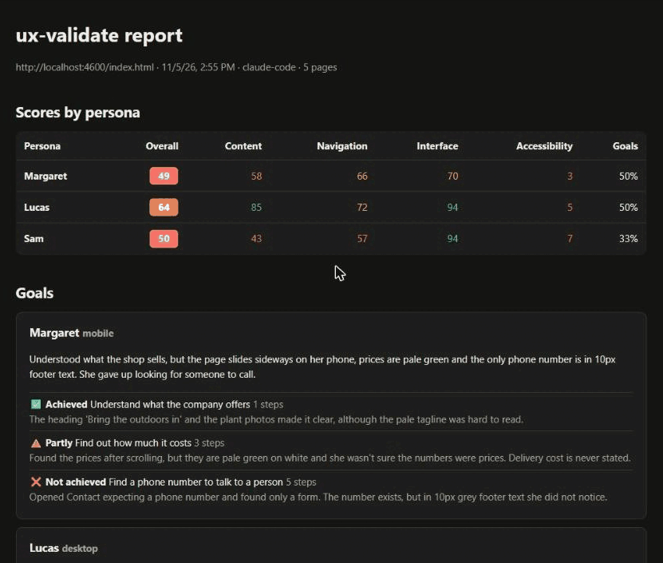

# ux-validate

[English](README.md) · **Português**

Testes de **conteúdo**, **navegação**, **interface** e **acessibilidade** de aplicações web, feitos do ponto de vista de **personas**, geradas por IA ou não, e executados pelo agente de IA que você já usa.

Em vez de só dizer "o contraste está abaixo de 4,5:1", o ux-validate responde: *a Dona Maria, de 68 anos, no celular, consegue descobrir quanto custa o seu produto?* E se não consegue, mostra onde ela travou, por quê e em qual arquivo corrigir.



> **Status:** versão inicial (0.5). Funciona com **Claude Code**, **Cursor**, **Codex CLI** e **Gemini CLI**.

## Como funciona

```
/ux-test
   │
   ├─ 1. Checagens fixas  (npx ux-validate check)
   │     axe-core, WAI-ARIA e teclado, links quebrados, erros de console,
   │     rolagem horizontal, ortografia, textos provisórios (lorem ipsum, NaN)…
   │     → mesmo resultado com qualquer modelo de linguagem
   │
   ├─ 2. Navegação como cada persona  (agente + Playwright MCP)
   │     tenta cumprir os objetivos dela, com as limitações dela,
   │     e avalia conteúdo, navegação, interface e acessibilidade
   │     pelo olhar dela; testa os widgets pelo teclado (padrões do APG)
   │     e revisa ortografia e gramática
   │
   ├─ 3. Aponta o arquivo provável de cada problema no seu código
   │
   └─ 4. Relatório  (npx ux-validate report)
         notas por persona, objetivos cumpridos, problemas com evidência
         e sugestão de correção → report.md + report.html

/ux-fix  ou  npx ux-validate fix
   └─ aplica as correções no código, mostrando cada mudança antes de gravar
```

O ux-validate roda **dentro da sua ferramenta de IA**: o modelo usado é o que ela estiver usando.

## Ferramentas de IA suportadas

O setup instala os mesmos comandos (`ux-test`, `ux-report`, `ux-fix`, `ux-persona`) no formato de cada ferramenta, além do servidor MCP do Playwright, que o agente usa como navegador. Dá para escolher várias ferramentas de uma vez.

| Ferramenta | Comandos instalados em | Como chamar | Navegador (MCP) registrado em |
|---|---|---|---|
| **Claude Code** | `.claude/skills/<nome>/SKILL.md` | `/ux-test` | `.mcp.json` |
| **Cursor** | `.cursor/commands/<nome>.md` | `/ux-test` no chat do agente | `.cursor/mcp.json` |
| **Codex CLI** | `.agents/skills/<nome>/SKILL.md` (com `agents/openai.yaml`) | `$ux-test` | `.codex/config.toml` |
| **Gemini CLI** | `.gemini/commands/<nome>.toml` | `/ux-test` | `.gemini/settings.json` |

Observações:

- Os comandos só rodam quando você os chama: os testes abrem navegador e gastam tokens. No Claude Code isso é o `disable-model-invocation`; no Codex, `allow_implicit_invocation: false`.
- O Codex lê o `.codex/config.toml` e o Gemini lê o `.gemini/settings.json` só em pastas **confiáveis**; aceite a pergunta na primeira vez que abrir o projeto.
- Arquivos de configuração existentes são preservados: o setup só adiciona o servidor `playwright` se ele não estiver lá.
- O servidor MCP do Playwright é instalado numa **versão fixa** (`@playwright/mcp@0.0.83`), não em `@latest`: assim nenhuma versão nova e não revisada é baixada e executada sem você saber. Se você instalou uma versão anterior do ux-validate, troque `@latest` pela versão fixa no arquivo de MCP da sua ferramenta.
- O Gemini CLI também lê `.agents/skills/`. Se você instalar Codex e Gemini juntos, o Gemini pode listar as skills do Codex; use os comandos `/ux-…`, e o Gemini pede confirmação antes de ativar qualquer skill.
- Os argumentos vão depois do nome do comando em todas as ferramentas, ex.: `/ux-test dona-maria` ou `$ux-test dona-maria`.

## Idiomas

O ux-validate fala **português** e **inglês**: mensagens do terminal, setup, relatório, achados das checagens e instruções do agente.

- O setup detecta o idioma do sistema e pergunta qual usar. A escolha fica em `locale` no `ux-validate.config.yml`.
- Para trocar só num comando: `npx ux-validate check --lang en`.
- O **idioma da ferramenta** (`locale`) é separado do **idioma do conteúdo** da aplicação (`language`), usado pela ortografia. Dá para usar a ferramenta em português testando um site em inglês, e vice-versa.

## Acessibilidade e WAI-ARIA

A categoria **Acessibilidade** combina três camadas:

| Camada | O que verifica |
|---|---|
| **axe-core** | Sintaxe do ARIA (papéis, atributos e valores válidos), nomes acessíveis, contraste, textos alternativos e demais regras WCAG 2.2 AA |
| **Checagens ARIA de comportamento** | Percorre cada página com `Tab` e encontra: armadilha de teclado, foco invisível, foco em elemento escondido, widgets com `role` que não recebem foco, elementos clicáveis sem acesso pelo teclado (`<div onclick>`), `aria-expanded` que não muda ao abrir e fechar, campos identificados só pelo placeholder |
| **Agente** | Testa cada widget pelo teclado seguindo o [ARIA Authoring Practices Guide](https://www.w3.org/WAI/ARIA/apg/) (diálogos, abas, acordeões, menus, combobox…), verifica se mensagens dinâmicas são anunciadas (`role="status"`/`alert`) e navega como uma pessoa que usa leitor de tela |

Cada execução salva também a **árvore de acessibilidade** de cada página em `.ux-validate/runs/<data-hora>/aria/`: papéis, nomes e estados, ou seja, o que um leitor de tela anuncia. O relatório liga cada problema de acessibilidade à árvore da página.

## Visão de cores (daltonismo)

Cerca de 1 em cada 12 homens e 1 em cada 200 mulheres têm algum tipo de daltonismo. O ux-validate simula como cada página aparece para essas pessoas e aponta a informação que elas perdem:

| Checagem | O que encontra |
|---|---|
| **Contraste com daltonismo** (`cvd-contrast`) | Texto que passa no contraste do WCAG para quem enxerga todas as cores, mas fica abaixo do mínimo com daltonismo (ex.: vermelho sobre fundo escuro com protanopia) |
| **Indicadores iguais** (`cvd-indicators`) | Bolinhas de status, marcadores de legenda e outros indicadores sem texto cujas cores ficam iguais (ex.: verde × vermelho com deuteranopia) |
| **Estado só pela cor** (`cvd-state`) | Aba, filtro ou item de menu selecionado que se diferencia dos vizinhos só pela cor e deixa de se destacar |

- A simulação cobre **protanopia**, **deuteranopia** e **tritanopia** (e, se você quiser, **acromatopsia**), com as matrizes de Machado, Oliveira e Fernandes (2009). As cores são comparadas com a diferença perceptual CIEDE2000.
- O relatório ganha a seção **Visão de cores**, com cada página como ela é vista com cada tipo de daltonismo. A evidência de cada problema é a imagem simulada.
- Esses problemas contam só para as personas com `vision: daltonismo` (ou `color-blind`), como a persona pré-definida **Carlos**. Quem enxerga todas as cores não perde nota por eles.
- No `/ux-test`, o agente compara as imagens e navega com o daltonismo simulado no navegador, procurando o que a checagem automática não pega: gráficos, erros de formulário só em vermelho, links destacados só pela cor.

Para escolher os tipos, ou desligar a etapa, use o `ux-validate.config.yml`:

```yaml
colorVision:
  enabled: true
  types: [protanopia, deuteranopia, tritanopia]   # também: achromatopsia
```

## Aplicações React

O ux-validate testa a aplicação no navegador, então funciona com qualquer React: Vite, Next.js, Create React App, React Router, Remix ou Gatsby. Para aplicações React e outras SPAs (que trocam de tela sem recarregar), ele faz mais:

- **Setup:** detecta o framework no `package.json` e sugere a URL e o comando do servidor de desenvolvimento (ex.: Vite → `http://localhost:5173` e `npm run dev`).
- **Onde corrigir:** no servidor de desenvolvimento, cada problema vem com o **componente** que desenhou o elemento (`Home › App`) e o **arquivo e a linha do JSX** (ex.: `src/App.jsx:9`), lidos das informações de debug do React e do source map do servidor. Isso vale para o relatório, o SARIF (anotação na linha certa do PR) e o `fix`.
- **Rotas:** espera o React desenhar a tela antes de analisar, segue rotas com History API e de hash (`#/planos`) e reconhece a tela de "página não encontrada" da aplicação, mesmo quando o servidor responde 200 (link quebrado em SPA).
- **Checagens próprias:**

| Checagem | O que encontra |
|---|---|
| Página em branco | Erro de renderização sem Error Boundary, que desmonta a árvore inteira |
| Avisos do React | Lista sem `key`, erro de hidratação, HTML aninhado de forma inválida, renderização em laço, campo controlado/não controlado |
| Troca de rota | Foco que não muda e nada anunciado ao leitor de tela; título da aba que não muda |
| Elementos clicáveis | `<div onClick>` do React, que não aparece como `onclick` no HTML |

Telas que não têm link (abertas por botão, por exemplo) entram pela configuração:

```yaml
crawl:
  routes: [/checkout, /conta/pedidos]
```

> Use o servidor de desenvolvimento para ter componentes, arquivos e linhas. Com o build de produção as checagens funcionam, mas os nomes vêm minificados e não há arquivo de origem.

Para ver funcionando, há um app de exemplo com problemas de propósito em `examples/react-demo`:

```bash
npm run demo:react
```

```bash
npx ux-validate check --url http://localhost:5173
```

## Verificação ortográfica

A ortografia é verificada **offline**, com o Hunspell e os dicionários do LibreOffice (em português, o VERO). Nenhum texto sai da sua máquina. Idiomas: português do Brasil, inglês e espanhol (`language` no `ux-validate.config.yml`).

- Aponta palavras desconhecidas com sugestões de correção (`excessão` → `exceção`) e palavras em inglês no meio de um texto em português.
- Ignora nomes próprios, marcas (`WhatsApp`), siglas, URLs, e-mails e variáveis de template.
- Palavras corretas que o dicionário não conhece (nome da empresa, termos técnicos) vão em `.ux-validate/dicionario.txt` (ou `dictionary.txt`, se a ferramenta estiver em inglês; os dois são lidos), uma por linha, ou em `spelling.ignore` na configuração.
- No `/ux-test`, o agente revisa esses achados, descarta os falsos positivos e revisa a **gramática** (concordância, crase, "mas" × "mais"…), que o dicionário não pega.

## Aplicando as correções

Depois do relatório, o ux-validate pode corrigir o código para você, de dois jeitos:

| | `/ux-fix` (no Claude Code) | `npx ux-validate fix` (no terminal) |
|---|---|---|
| **Modelo** | O que o Claude Code estiver usando | O provedor e o modelo escolhidos no setup: Anthropic, OpenAI, Google ou Ollama (local) |
| **Custo** | Consumo da sua conta no Claude Code | Tokens cobrados na **sua** conta do provedor, com a **sua** API key |
| **Como funciona** | O agente corrige um problema de cada vez e roda as checagens de novo para confirmar | Envia cada arquivo com os problemas dele ao modelo, recebe as trocas de texto propostas e mostra o diff antes de gravar |

Os dois corrigem só o que está no relatório, preferem HTML semântico a ARIA e **nunca inventam dados** (telefone, preço, depoimento): quando falta informação, avisam o que é preciso.

```bash
npx ux-validate fix                       # problemas críticos, altos e médios da última execução
npx ux-validate fix --ids A001,C003       # só esses problemas
npx ux-validate fix --severity high       # só críticos e altos
npx ux-validate fix --dry-run             # mostra as correções sem gravar
```

Antes de chamar o modelo, o `fix` mostra quais arquivos vai enviar e uma estimativa de tokens, e pede confirmação. Cada troca proposta precisa bater exatamente com um trecho único do arquivo; as que não batem são descartadas. Os arquivos originais ficam salvos em `.ux-validate/runs/<data-hora>/fixes/backup/`, e o resultado de cada problema (com os tokens usados) em `fixes/fixes.json`.

> **Privacidade:** no `fix` pelo terminal, o conteúdo dos arquivos corrigidos é enviado ao provedor escolhido. Com o Ollama, tudo roda na sua máquina.

A API key nunca fica no `ux-validate.config.yml`, que guarda só o nome da variável de ambiente. Defina a chave antes de rodar:

```powershell
$env:ANTHROPIC_API_KEY="sua-chave"
```

```bash
export ANTHROPIC_API_KEY=sua-chave
```

## Instalação

### Plugin do Claude Code (recomendado para o Claude Code)

Instale uma vez e use em qualquer projeto. No Claude Code:

```
/plugin marketplace add fabiofigueredo/ux-validate
```

```
/plugin install ux-validate@ux-validate
```

Depois, no projeto que você quer testar:

| Skill | O que faz |
|---|---|
| `/ux-validate:ux-setup` | Configura o projeto: idioma, URL da aplicação, comando para subi-la e personas (uma vez) |
| `/ux-validate:ux-test` | Testa com todas as personas e gera o relatório |
| `/ux-validate:ux-report` | Refaz o relatório e monta um plano de correção |
| `/ux-validate:ux-fix` | Aplica as correções do relatório |
| `/ux-validate:ux-persona` | Cria uma persona conversando com você |

- O plugin traz o navegador que o agente usa (Playwright MCP) e os guias de referência; nada é copiado para o projeto.
- As instruções do plugin são em inglês, mas o agente conversa com você e escreve o relatório no idioma definido no projeto (`locale`: `pt-BR` ou `en`), escolhido no `/ux-validate:ux-setup`.
- As skills chamam a CLI fixada na versão do plugin (`npx -y ux-validate@<versão>`), então não é preciso instalar o pacote do npm. Requer **Node.js 20+**.
- Atualizações: `/plugin marketplace update ux-validate` e depois atualize o plugin em `/plugin` (ou ative a atualização automática do marketplace ali).
- Se você já usou o `npx ux-validate init` com o Claude Code, apague as pastas `.claude/skills/ux-*` do projeto e a entrada `playwright` do `.mcp.json`, para não ficar com comandos duplicados.

### Pacote do npm (Cursor, Codex CLI, Gemini CLI, CI)

Pré-requisitos: **Node.js 20+** e uma das ferramentas de IA suportadas: **Claude Code**, **Cursor**, **Codex CLI** ou **Gemini CLI**.

No projeto que você quer testar:

```bash
npm install -D ux-validate
```

```bash
npx ux-validate install-browser
```

```bash
npx ux-validate init
```

O setup pergunta:

- o **idioma da ferramenta** (português ou inglês);
- **em quais ferramentas de IA** você vai usar os comandos (Claude Code, Cursor, Codex CLI, Gemini CLI; uma ou mais);
- a **URL** da aplicação e, opcionalmente, o comando para subi-la;
- os **tamanhos de tela** (mobile, tablet, desktop);
- o **idioma do conteúdo**, para a verificação ortográfica;
- se quer configurar um **modelo para aplicar correções pelo terminal** (`npx ux-validate fix`), escolhendo **provedor** (Anthropic, OpenAI, Google, Ollama), **modelo** e o nome da variável de ambiente com a sua API key;
- **quais personas usar** (passo obrigatório): o setup mostra as personas pré-definidas com as características de cada uma e você escolhe entre usá-las (todas ou só algumas), criar as suas ali mesmo ou as duas coisas. Veja [Personas](#personas).

E cria:

| Arquivo | Para quê |
|---|---|
| `ux-validate.config.yml` | Configuração |
| `.ux-validate/personas/*.yml` | Suas personas |
| `.ux-validate/references/` | Heurísticas e formatos que o agente consulta |
| `.ux-validate/dicionario.txt` | Palavras corretas que o dicionário não conhece |
| Os comandos e o MCP de cada ferramenta escolhida | Veja [Ferramentas de IA suportadas](#ferramentas-de-ia-suportadas) |

Use `--yes` para aceitar os padrões sem perguntas, `--tools claude-code,cursor,codex,gemini` para escolher as ferramentas sem perguntas, `--personas all|none|dona-maria,rafael-dev` para escolher as personas pré-definidas sem perguntas (padrão: `all`) e `--force` para sobrescrever arquivos existentes.

> **Atualizando de uma versão anterior?** Os comandos de agente mudaram de nome: `/persona-test` → `/ux-test`, `/persona-report` → `/ux-report`, `/persona-fix` → `/ux-fix` e `/persona-new` → `/ux-persona`. Rode `npx ux-validate init` de novo: ele instala os novos e remove os antigos que ele mesmo tinha criado.

## Uso

Na sua ferramenta de IA, dentro do seu projeto (no Codex, use `$` no lugar de `/`):

| Comando | O que faz |
|---|---|
| `/ux-persona` | Cria uma persona conversando com você sobre quem usa a aplicação |
| `/ux-test` | Testa com todas as personas e gera o relatório |
| `/ux-test dona-maria` | Testa com uma persona só |
| `/ux-test --only accessibility` | Avalia só uma categoria (`content`, `navigation`, `ui`, `accessibility`) |
| `/ux-report` | Refaz o relatório da última execução e monta um plano de correção |
| `/ux-report --compare` | Mostra o que foi resolvido, o que continua e o que é novo |
| `/ux-fix` | Aplica as correções do relatório (críticos, altos e médios) |
| `/ux-fix A001,C003` | Aplica só as correções desses problemas |

Pelo terminal (útil no CI):

```bash
npx ux-validate persona examples # mostra as personas pré-definidas e suas características
npx ux-validate persona add all  # copia as pré-definidas para o projeto (ou: add dona-maria)
npx ux-validate persona new      # cria uma persona com um assistente passo a passo
npx ux-validate persona validate # confere os arquivos de persona
npx ux-validate check            # só as checagens fixas
npx ux-validate report           # relatório da execução mais recente
npx ux-validate fix              # aplica as correções com o modelo configurado no setup
```

Os resultados ficam em `.ux-validate/runs/<data-hora>/` (já incluído no `.gitignore`).

## GitHub Action

Roda as checagens fixas em todo pull request, com um comentário de resumo no PR, anotações nas linhas alteradas (SARIF / code scanning) e o relatório completo como artefato para baixar.

```yaml
# .github/workflows/ux-validate.yml
name: ux-validate
on: pull_request

permissions:
  contents: read
  pull-requests: write   # comentário no PR
  security-events: write # envio do SARIF ao code scanning

jobs:
  ux:
    runs-on: ubuntu-latest
    steps:
      - uses: actions/checkout@v7
      - uses: actions/setup-node@v7
        with:
          node-version: 22
      - run: npm ci
      - uses: fabiofigueredo/ux-validate@v1
        with:
          start: npm run dev
          url: http://localhost:3000
          fail-on: critical
          language: pt-BR
```

| Entrada | Padrão | O que faz |
|---|---|---|
| `url` | `app.url` da configuração | URL a testar (servidor local ou deploy de preview) |
| `start` | — | Comando que sobe a aplicação em segundo plano; a Action espera a URL responder |
| `wait-timeout` | `120` | Segundos de espera pela URL |
| `working-directory` | `.` | Pasta da aplicação (monorepos) |
| `fail-on` | — (nunca falha) | Falha o job com problemas dessa gravidade ou mais graves: `critical`, `high`, `medium`, `low` |
| `comment` | `true` | Comenta o resumo no PR, atualizando o mesmo comentário a cada push |
| `sarif` | `true` | Envia o SARIF para o code scanning |
| `upload-sarif` | `true` | Com `false`, gera o arquivo SARIF (fica no artefato do relatório) sem enviar ao code scanning, ex.: ao testar num site de demonstração com problemas de propósito |
| `language` | `locale` da configuração, depois inglês | `en` ou `pt-BR` para o comentário e o relatório |

Saídas: `issues`, `critical`, `high`, `report-dir`, `sarif-file`. O resumo também aparece na página de resumo do job.

Observações:

- `@v1` aponta sempre para a última versão estável da Action. Para fixar uma versão exata, use a tag de uma release, como `@v0.3.0`.
- A Action roda as **checagens fixas** (acessibilidade, WAI-ARIA, links, ortografia, layout). A avaliação por persona precisa de uma ferramenta de IA e roda localmente com `/ux-test`.
- O code scanning é gratuito em repositórios públicos; nos privados, exige o GitHub Advanced Security. Sem ele, o envio do SARIF é pulado com um aviso e o resto funciona.
- Em pull requests vindos de forks, o GitHub dá um token só de leitura: o comentário é pulado com um aviso.
- Há um workflow de exemplo em [`examples/github-workflow.yml`](examples/github-workflow.yml).

Sem a Action, em qualquer CI:

```bash
npx ux-validate check --url http://localhost:3000 --fail-on high   # código de saída 2 ao atingir o limite
npx ux-validate sarif --out ux-validate.sarif
npx ux-validate comment --out comment.md
```

## Personas

Uma persona é um tipo real de usuário da sua aplicação, escrito como um arquivo YAML em `.ux-validate/personas/`. Sem pelo menos uma persona não há teste, então **escolher as personas é um passo obrigatório**: no setup e, se a pasta estiver vazia, no início do `/ux-test`, que mostra as pré-definidas e pergunta o que você prefere antes de abrir o navegador.

### Personas pré-definidas

| Persona | Quem é | Aparelho | Tecnologia | Visão | Paciência | Leitura | Objetivos |
|---|---|---|---|---|---|---|---|
| **Dona Maria** (`dona-maria`) | 68 anos, aposentada; usa WhatsApp e o app do banco, às vezes com ajuda da neta | Celular | Baixa | Reduzida | Baixa | Básico | Entender o que a empresa oferece; descobrir quanto custa; achar telefone ou WhatsApp |
| **Lucas** (`lucas-leitor-de-tela`) | 35 anos, analista financeiro, cego desde a infância; navega com leitor de tela e teclado | Computador | Alta | Leitor de tela | Média | Avançado | Entender a oferta navegando só pelos títulos; preencher o formulário de contato |
| **Rafael** (`rafael-dev`) | 29 anos, desenvolvedor; avalia ferramentas para o time e compara com concorrentes | Computador | Alta | Normal | Média | Avançado | Comparar planos e limites; criar conta de teste; achar a documentação |
| **Carlos** (`carlos-daltonico`) | 45 anos, gerente comercial; tem deuteranopia (daltonismo vermelho-verde) | Computador | Média | Daltonismo | Média | Intermediário | Descobrir o preço; saber qual opção está selecionada; entender os erros de um formulário |

Para ver a ficha completa (com expectativas) rode `npx ux-validate persona examples`; para adicioná-las depois, `npx ux-validate persona add <id>` ou `all`. Ajuste os objetivos ao seu produto.

### Criar as suas

- **`/ux-persona` no Claude Code:** o agente entrevista você sobre o usuário real (quem é, que aparelho usa, limitações, o que vem fazer), pode olhar a aplicação para sugerir objetivos, mostra o arquivo e grava depois da sua confirmação. Dá para começar com uma descrição: `/ux-persona cliente idoso que compra pelo celular`.
- **`npx ux-validate persona new` no terminal:** um assistente passo a passo, com perguntas de múltipla escolha para cada característica. Não usa modelo de linguagem.

Os dois conferem o arquivo com `npx ux-validate persona validate`, que você também pode rodar a qualquer momento para checar todas as personas do projeto (campos obrigatórios, valores válidos, ids repetidos).

```yaml
id: dona-maria
name: Dona Maria
description: 68 anos, aposentada, usa o celular com ajuda da neta.
viewport: mobile
traits:
  tech_literacy: baixa      # aumenta o peso de jargão e ícones sem rótulo
  vision: reduzida          # aumenta o peso de contraste e fontes pequenas
  patience: baixa           # desiste após poucos passos sem progresso
  language: pt-BR
  reading_level: básico
goals:
  - Descobrir quanto custa
  - Encontrar um telefone ou WhatsApp
```

Formato completo e efeito de cada característica: [`source/pt-BR/references/persona-format.md`](source/pt-BR/references/persona-format.md). Os valores das características podem estar em português ou em inglês (`low`, `reduced`, `screen-reader`…).

## Experimente com o site de demonstração

`examples/demo-site` é um site com problemas plantados de propósito (links quebrados, lorem ipsum, layout que estoura no celular, formulário inacessível, abas e acordeão com ARIA errado…). Ótimo para ver a ferramenta funcionando antes de usar no seu projeto.

**1. Clone e suba o site** (deixe este terminal aberto):

```bash
git clone https://github.com/fabiofigueredo/ux-validate.git
```

```bash
cd ux-validate && npm install && node bin/ux-validate.js install-browser
```

```bash
npm run demo:serve
```

O site fica em http://localhost:4321/index.html.

**2. Crie um projeto de teste** em outro terminal, ao lado da pasta `ux-validate`:

```bash
mkdir projeto-teste && cd projeto-teste && npm init -y
```

```bash
npm install -D ../ux-validate
```

```bash
npx ux-validate init
```

Quando o setup pedir a URL, informe `http://localhost:4321/index.html`.

> Também dá para testar arquivos HTML direto do disco, sem servidor, usando uma URL `file://` (ex.: `file:///C:/projetos/meu-site/index.html`). Prefira `http://` sempre que a aplicação tiver um servidor: é como o usuário real vai acessá-la.

**3. Rode as checagens fixas:**

```bash
npx ux-validate check
```

```bash
npx ux-validate report
```

Abra o `report.html` em `.ux-validate/runs/<data-hora>/`.

**4. Rode o teste com personas:** abra a pasta `projeto-teste` no VS Code, abra o Claude Code, aprove o servidor MCP `playwright` (ou ative-o com `/mcp`) e digite `/ux-test dona-maria`.

`examples/sample-findings.json` mostra o tipo de resultado que o agente produz.

### Problemas comuns

| Sintoma | Solução |
|---|---|
| `/ux-test` não aparece | A pasta aberta precisa ser a do projeto onde você rodou o `init` (a que tem `.claude/`, `.cursor/`, `.agents/` ou `.gemini/`). No Gemini CLI, rode `/commands reload` |
| O agente não tem as ferramentas de navegador | Aprove ou ative o servidor MCP `playwright` na sua ferramenta; no Codex e no Gemini, marque a pasta do projeto como confiável |
| Erro dizendo que o navegador não foi encontrado | Rode `npx ux-validate install-browser` no projeto |
| "A página inicial não abre" | Confira se a aplicação está no ar e se `app.url` está certa |
| Quer mudar a URL depois do setup | Edite `app.url` em `ux-validate.config.yml` |

## Estrutura do projeto

```
bin/ux-validate.js       CLI (init, check, report, fix, persona)
src/init.js              setup interativo
src/checks.js            checagens determinísticas (Playwright + axe-core)
src/aria.js              checagens de WAI-ARIA e teclado
src/spelling.js          verificação ortográfica (Hunspell)
src/fix.js               correção automática a partir do relatório
src/llm.js               clientes dos provedores (Anthropic, OpenAI, Google, Ollama)
src/persona.js           assistente e validação de personas
src/report.js            notas e relatório (Markdown + HTML)
src/sarif.js             exportação SARIF (code scanning do GitHub)
src/comment.js           comentário de pull request
action.yml               GitHub Action
src/i18n.js              idioma da ferramenta
src/locales/             mensagens em inglês (en.js) e português (pt-BR.js)
src/adapters/            um adapter por ferramenta de IA
source/<idioma>/commands/    comandos escritos uma vez, independentes da ferramenta
source/<idioma>/references/  heurísticas, guia de conteúdo, guia WAI-ARIA, formatos de persona e de achados
source/<idioma>/personas/    personas de exemplo
examples/                site de demonstração e resultados de exemplo
test/                    testes (npm test)
```

### Adicionando uma ferramenta de IA

Os comandos em `source/<idioma>/commands/` usam placeholders (`{{WORK_DIR}}`, `{{CHECK_CMD}}`…) e não dependem de ferramenta. Para suportar uma nova, crie `src/adapters/<ferramenta>.js` com `{ id, label, available: true, invoke(name), install({ cwd, commands, force }) }`, gravando os comandos no formato que ela entende (`src/adapters/shared.js` tem funções para adaptar o marcador de argumentos e registrar o servidor MCP), registre-o em `src/adapters/index.js` e adicione a linha de próximos passos em `init.next.tools` nos catálogos de mensagens.

## Roadmap

- [x] Setup interativo, adapter do Claude Code, `/ux-test` e `/ux-report`
- [x] Checagens fixas e relatório com notas por persona
- [x] Acessibilidade com WAI-ARIA e verificação ortográfica
- [x] `/ux-fix` e `npx ux-validate fix` (aplicar correções com o modelo do usuário)
- [x] Inglês e português
- [x] Adapters para Cursor, Codex CLI e Gemini CLI
- [x] GitHub Action com comentário no PR e saída SARIF
- [x] `/ux-persona` e `npx ux-validate persona new` (criar personas)
- [x] Aplicações React: componente, arquivo e linha de cada problema, rotas de SPA e avisos do React
- [x] Visão de cores: simulação de daltonismo, checagens de contraste, indicadores e estado só pela cor
- [x] Plugin do Claude Code (`/plugin install ux-validate@ux-validate`)
- [ ] Navegação com personas pelo terminal (sem ferramenta de IA), com o modelo escolhido no setup
- [ ] Repetir a navegação e só confirmar problemas que aparecem em mais de uma execução

### Adicionando um idioma

1. Copie `src/locales/en.js` para `src/locales/<idioma>.js`, traduza e registre em `src/i18n.js`.
2. Copie `source/en/` para `source/<idioma>/` e traduza comandos, referências e personas.
3. Rode `npm test`: um teste confere que todos os catálogos têm as mesmas chaves.

## Contribuindo

Sugestões e PRs são bem-vindos. Antes de abrir um PR, rode `npm test`. Para mudar o comportamento do agente, edite os comandos em `source/<idioma>/commands/` e as referências em `source/<idioma>/references/` (mantenha os dois idiomas em sincronia): eles valem para todas as ferramentas.

## Variáveis de ambiente

| Variável | Uso |
|---|---|
| `UX_VALIDATE_CHROMIUM` | Caminho de um Chromium já instalado, se não quiser usar o do Playwright |
| `ANTHROPIC_API_KEY`, `OPENAI_API_KEY`, `GOOGLE_GENERATIVE_AI_API_KEY` | API key usada pelo `npx ux-validate fix` (o nome da variável é configurável no setup) |
| `UX_VALIDATE_LOCALE` | Idioma da ferramenta (`en` ou `pt-BR`) quando não há `locale` na configuração |
| `DEBUG` | Mostra o erro completo quando um comando falha |

## Licença

[MIT](LICENSE) © Fabio Figueredo
